<!-- Generated from data/README.template.md by scripts/build_blueprint.py. Edit the template, not this file. -->
<picture>
  <source media="(max-width: 600px)" srcset="assets/blueprint/hero-mobile.svg" />
  
</picture>

<b><a href="#featured-systems">Featured systems</a> &nbsp;·&nbsp; <a href="#engineering-decisions">Engineering decisions</a> &nbsp;·&nbsp; <a href="#more-builds">More builds</a> &nbsp;·&nbsp; <a href="#build-kit">Build kit</a> &nbsp;·&nbsp; <a href="#get-in-touch">Get in touch</a></b>

## About

I'm **Aditya Singh**. I study **Data Science & Applications at IIT Madras**, co-enrolled at **Scaler School of Technology**, and I build LLM systems, local desktop agents and full-stack products. My projects span contract intelligence, local desktop agents, multimodal retrieval and full-stack applications.

What interests me most is the gap between a model producing an answer and a system doing something dependable with it. I work with retrieval, explicit checks and human approval to make that gap easier to inspect.

**The model proposes. The system checks. The person stays in control.** Every drawing below uses the same three symbols:

<code>◇ model proposes</code> &nbsp; <code>■ system checks</code> &nbsp; <code>● person decides</code>

**Read the situation. Coordinate the squad. Review the mistakes. Queue again.** That's the BGMI mindset I bring to a build.

## Featured systems

Three systems, drawn from their actual code paths. Links under each drawing go to the exact lines.

<a href="https://github.com/Aditya2514/LexGuard">
<picture>
  <source media="(max-width: 600px)" srcset="assets/blueprint/lexguard-mobile.svg" />
  
</picture>
</a>

**LexGuard.** Makes contract risks easier to inspect before signing. It reviews contracts under Indian law using statutory retrieval and deterministic risk checks: a staged agent pipeline examines clauses, checks explicit traps, verifies citations and proposes rewrites, and the deterministic checks can escalate the model's risk assessment.

Node.js · React · MongoDB · Redis &nbsp; **In the code:** [`jobQueueService.js:107`](https://github.com/Aditya2514/LexGuard/blob/2e6cb460aa9efabc2a51d3aa3c7aaf02849169a5/backend/src/services/jobQueueService.js#L107) · [`citationVerifier.js:404`](https://github.com/Aditya2514/LexGuard/blob/2e6cb460aa9efabc2a51d3aa3c7aaf02849169a5/backend/src/services/citationVerifier.js#L404) · [`package.json:8`](https://github.com/Aditya2514/LexGuard/blob/2e6cb460aa9efabc2a51d3aa3c7aaf02849169a5/backend/package.json#L8)

<a href="https://github.com/Aditya2514/Pikina">
<picture>
  <source media="(max-width: 600px)" srcset="assets/blueprint/pikina-mobile.svg" />
  
</picture>
</a>

**Pikina.** Lets a local assistant help with your computer while keeping meaningful actions inspectable. It's an offline-first Windows/Linux assistant with local inference, validated tools and consent for high-risk actions: regex-first routing handles known intents, Ollama handles the rest, an action validator checks every proposed tool call, and plans support rollback.

Python · Electron · Ollama · SQLite &nbsp; **In the code:** [`schema_check.py:10`](https://github.com/Aditya2514/Pikina/blob/4bcbcec85180db750df0844f2a55d34b2b016d21/src/pikina/validation/schema_check.py#L10) · [`gatekeeper.py:16`](https://github.com/Aditya2514/Pikina/blob/4bcbcec85180db750df0844f2a55d34b2b016d21/src/pikina/registry/gatekeeper.py#L16) · [`rollback_engine.py:15`](https://github.com/Aditya2514/Pikina/blob/4bcbcec85180db750df0844f2a55d34b2b016d21/src/pikina/transactions/rollback_engine.py#L15)

<a href="https://github.com/Aditya2514/Noesis">
<picture>
  <source media="(max-width: 600px)" srcset="assets/blueprint/noesis-mobile.svg" />
  
</picture>
</a>

**Noesis.** Finds the useful moment across a collection of mixed media. It searches video, audio, PDFs and images, then links each answer to a timestamp or page: BM25 and dense retrieval feed a reranker, and source citations plus an LLM fact audit make the response inspectable. Built with **Apurva Patil**.

Python · ChromaDB · Whisper · Streamlit &nbsp; **In the code:** [`hybrid_retrieve.py:177`](https://github.com/Aditya2514/Noesis/blob/fde4e09283833cd25ec9e58777d0f6d74fa33bce/hybrid_retrieve.py#L177) · [`hybrid_retrieve.py:28`](https://github.com/Aditya2514/Noesis/blob/fde4e09283833cd25ec9e58777d0f6d74fa33bce/hybrid_retrieve.py#L28) · [`grounded_generate.py:205`](https://github.com/Aditya2514/Noesis/blob/fde4e09283833cd25ec9e58777d0f6d74fa33bce/grounded_generate.py#L205) · [`grounded_generate.py:98`](https://github.com/Aditya2514/Noesis/blob/fde4e09283833cd25ec9e58777d0f6d74fa33bce/grounded_generate.py#L98)

## Engineering decisions

The decisions underneath the drawings, each linked to the line that implements it.

| System | Design decision | In the code |
| :-- | :-- | :-- |
| [LexGuard](https://github.com/Aditya2514/LexGuard) | Deterministic trap checks run before the LLM agents read a risk level, and can escalate it. Statute citations are verified against a legal database. The backend is sized to run in 512 MB. | [`jobQueueService.js:107`](https://github.com/Aditya2514/LexGuard/blob/2e6cb460aa9efabc2a51d3aa3c7aaf02849169a5/backend/src/services/jobQueueService.js#L107) [`citationVerifier.js:404`](https://github.com/Aditya2514/LexGuard/blob/2e6cb460aa9efabc2a51d3aa3c7aaf02849169a5/backend/src/services/citationVerifier.js#L404) [`package.json:8`](https://github.com/Aditya2514/LexGuard/blob/2e6cb460aa9efabc2a51d3aa3c7aaf02849169a5/backend/package.json#L8) |
| [Pikina](https://github.com/Aditya2514/Pikina) | Validate every model proposal against registered capabilities; ask for consent when an action is high-risk or can't be rolled back; roll plans back step by step. | [`schema_check.py:10`](https://github.com/Aditya2514/Pikina/blob/4bcbcec85180db750df0844f2a55d34b2b016d21/src/pikina/validation/schema_check.py#L10) [`gatekeeper.py:16`](https://github.com/Aditya2514/Pikina/blob/4bcbcec85180db750df0844f2a55d34b2b016d21/src/pikina/registry/gatekeeper.py#L16) [`rollback_engine.py:15`](https://github.com/Aditya2514/Pikina/blob/4bcbcec85180db750df0844f2a55d34b2b016d21/src/pikina/transactions/rollback_engine.py#L15) |
| [Noesis](https://github.com/Aditya2514/Noesis) | Fuse BM25 and dense retrieval, rerank on a local cross-encoder, audit every claim in the answer, and cite pages and timestamps. | [`hybrid_retrieve.py:177`](https://github.com/Aditya2514/Noesis/blob/fde4e09283833cd25ec9e58777d0f6d74fa33bce/hybrid_retrieve.py#L177) [`hybrid_retrieve.py:28`](https://github.com/Aditya2514/Noesis/blob/fde4e09283833cd25ec9e58777d0f6d74fa33bce/hybrid_retrieve.py#L28) [`grounded_generate.py:205`](https://github.com/Aditya2514/Noesis/blob/fde4e09283833cd25ec9e58777d0f6d74fa33bce/grounded_generate.py#L205) [`grounded_generate.py:98`](https://github.com/Aditya2514/Noesis/blob/fde4e09283833cd25ec9e58777d0f6d74fa33bce/grounded_generate.py#L98) |
| [Resilion](https://github.com/Aditya2514/Resilion) | Turn news into structured risk events, reject trade corridors the graph doesn't know, and trace affected industries. | [`risk_agent.py:194`](https://github.com/Aditya2514/Resilion/blob/c6c3dbb3c883da1731f3ecaac6666d49ff75bf2e/backend/agents/risk_agent.py#L194) [`traversal.py:34`](https://github.com/Aditya2514/Resilion/blob/c6c3dbb3c883da1731f3ecaac6666d49ff75bf2e/backend/graph/traversal.py#L34) |
| [HostelDesk](https://github.com/Aditya2514/HostelDesk) | Explain every delay in plain language and escalate missed deadlines automatically. | [`eta.service.ts:78`](https://github.com/Aditya2514/HostelDesk/blob/9c978ace415069e1f1f8b07e55d0869ec28b1260/server/src/modules/scheduling/eta.service.ts#L78) [`escalation.job.ts:21`](https://github.com/Aditya2514/HostelDesk/blob/9c978ace415069e1f1f8b07e55d0869ec28b1260/server/src/jobs/escalation.job.ts#L21) |
| [ShopKart](https://github.com/Aditya2514/Shopkart) | Recompute order totals on the server and accept a payment only after verifying its signature. | [`order.controller.js:71`](https://github.com/Aditya2514/Shopkart/blob/3a909ed607c55817e66ba5d623886d44ea2e0460/server/controllers/order.controller.js#L71) [`order.controller.js:171`](https://github.com/Aditya2514/Shopkart/blob/3a909ed607c55817e66ba5d623886d44ea2e0460/server/controllers/order.controller.js#L171) |
| [C++ Shell](https://github.com/Aditya2514/codecrafters-shell-cpp) | Wire pipelines by hand with fork, pipe and dup2; parse quoting with a state machine. | [`main.cpp:366`](https://github.com/Aditya2514/codecrafters-shell-cpp/blob/c4adda13d0f55a81f540b209b496a4cb087a1e1d/src/main.cpp#L366) [`main.cpp:369`](https://github.com/Aditya2514/codecrafters-shell-cpp/blob/c4adda13d0f55a81f540b209b496a4cb087a1e1d/src/main.cpp#L369) [`main.cpp:168`](https://github.com/Aditya2514/codecrafters-shell-cpp/blob/c4adda13d0f55a81f540b209b496a4cb087a1e1d/src/main.cpp#L168) |
| [Meta OpenEnv](https://github.com/Aditya2514/Meta_OpenEnv) | Grade agent schedules on finishing the work and on keeping every day under 8 hours. | [`environment.py:106`](https://github.com/Aditya2514/Meta_OpenEnv/blob/328688b03ec3310cf8498f83ad6fd8dd7e1b00f6/src/envs/assignment_planner/environment.py#L106) [`graders.py:190`](https://github.com/Aditya2514/Meta_OpenEnv/blob/328688b03ec3310cf8498f83ad6fd8dd7e1b00f6/src/envs/assignment_planner/graders.py#L190) |

## More builds

| Project | What it does | Stack |
| :-- | :-- | :-- |
| [Resilion](https://github.com/Aditya2514/Resilion) | Supply-chain intelligence: a Risk Watcher turns news into structured events and an impact graph traces who is affected. | Python · NetworkX · Gemini |
| [HostelDesk](https://github.com/Aditya2514/HostelDesk) | Hostel complaints with explained ETA ranges, automatic routing and escalation. | TypeScript · React · Express · PostgreSQL · Prisma |
| [Meta OpenEnv](https://github.com/Aditya2514/Meta_OpenEnv) | An environment for agents juggling assignments, bugs, deadlines and burnout constraints. Team hackathon project. | Python · FastAPI · Docker |
| [ShopKart](https://github.com/Aditya2514/Shopkart) | Server-authoritative checkout and Razorpay test-mode payments. Built with Apurva Patil. | React · Express · MongoDB |
| [C++ Shell](https://github.com/Aditya2514/codecrafters-shell-cpp) | A shell built around fork, exec, pipe and dup2: quoting, redirection, pipelines and background jobs. | C++23 · POSIX · CMake |
| [Vidya](https://github.com/Aditya2514/Vidya) | Book discovery with debounced search, Google sign-in and persistent saved lists. | React Native · TypeScript · Firebase |
| [Fintrac](https://github.com/Aditya2514/Fintrac) | A personal budgeting dashboard with Gemini-powered spending analysis. | React · Vite · Recharts · Gemini |
| [Naukri](https://github.com/Aditya2514/Naukri) | A job-portal UI with search, saved jobs and a simulated listings API. | React · Vite |

[All repositories →](https://github.com/Aditya2514?tab=repositories)

## Build kit

<picture>
  <source media="(max-width: 600px)" srcset="assets/blueprint/parts-mobile.svg" />
  
</picture>

## Build log

Recent changes across the featured systems and builds.

| Date | Project | Change |
| :-- | :-- | :-- |
| 2026‑10‑27 | [HostelDesk](https://github.com/Aditya2514/HostelDesk) | [docs: make the roadmap visual with three animated diagrams](https://github.com/Aditya2514/HostelDesk/commit/9c978ace415069e1f1f8b07e55d0869ec28b1260) |
| 2026‑10‑27 | [HostelDesk](https://github.com/Aditya2514/HostelDesk) | [docs: add roadmap of planned ML/AI features](https://github.com/Aditya2514/HostelDesk/commit/69b943303620719421c571856ace0a826acbf1e5) |
| 2026‑10‑22 | [Pikina](https://github.com/Aditya2514/Pikina) | [fix(switcher): review findings — Ctrl+C, git config execution, robustness](https://github.com/Aditya2514/Pikina/commit/21e6e432e8653851d9680c458f8814e7e942b6e9) |
| 2026‑10‑22 | [Pikina](https://github.com/Aditya2514/Pikina) | [feat: project switcher ("work on &lt;project&gt;") as the built-in workspace plugin](https://github.com/Aditya2514/Pikina/commit/a1b73fa721aaa649689d0b1412fa3d13e56c6f09) |
| 2026‑10‑21 | [Resilion](https://github.com/Aditya2514/Resilion) | [docs: separate what Resilion does today from what is planned](https://github.com/Aditya2514/Resilion/commit/c6c3dbb3c883da1731f3ecaac6666d49ff75bf2e) |
| 2026‑10‑21 | [Noesis](https://github.com/Aditya2514/Noesis) | [chore: remove unreferenced AI-generated concept images](https://github.com/Aditya2514/Noesis/commit/fde4e09283833cd25ec9e58777d0f6d74fa33bce) |
| 2026‑10‑21 | [Noesis](https://github.com/Aditya2514/Noesis) | [docs: match the README to the code](https://github.com/Aditya2514/Noesis/commit/9a577ee07c7c357d248b7fc14ad0b2b217ffd6e7) |
| 2026‑10‑21 | [LexGuard](https://github.com/Aditya2514/LexGuard) | [docs: align the README with the code](https://github.com/Aditya2514/LexGuard/commit/2e6cb460aa9efabc2a51d3aa3c7aaf02849169a5) |
| 2026‑10‑21 | [LexGuard](https://github.com/Aditya2514/LexGuard) | [chore: move one-off dev scripts and fixtures out of backend/ into scripts/dev](https://github.com/Aditya2514/LexGuard/commit/51ab388ddf1ef0df12add698b68840c220b4716c) |
| 2026‑10‑16 | [C++ Shell](https://github.com/Aditya2514/codecrafters-shell-cpp) | [docs: replace the CodeCrafters template README with what this shell does](https://github.com/Aditya2514/codecrafters-shell-cpp/commit/c4adda13d0f55a81f540b209b496a4cb087a1e1d) |

## Record

| Education | Achievement |
| :-- | :-- |
| **IIT Madras** · BS Data Science & Applications · 2025–2029 · CGPA **9.0/10** | **Runner-up** · Paradox DSA Triathlon · IIT Madras · 2026 |
| **Scaler School of Technology** · 2025–2029 | **Meta PyTorch OpenEnv Hackathon** · 2026 · team submission |

## Get in touch

Interested in **AI engineering internships**, **agent systems**, or a **hackathon project**? Send me the problem you're working on.

**[LinkedIn ↗](https://www.linkedin.com/in/aditya-singh-8286b137a/)** &nbsp;·&nbsp; **[Email ↗](mailto:adityasinghv05@gmail.com)** &nbsp;·&nbsp; **[All repositories ↗](https://github.com/Aditya2514?tab=repositories)**

Drawings and code links regenerate every six hours · last run 15 Nov 2026, 16:26 UTC

