<!-- Generated from data/README.template.md by scripts/build_aurora.py. Edit the template, not this file. -->

[ LINKEDIN ](https://www.linkedin.com/in/aditya-singh-8286b137a/) &nbsp;·&nbsp; [ EMAIL ](mailto:adityasinghv05@gmail.com) &nbsp;·&nbsp; [ HOSTELDESK LIVE ](https://hostel-desk-three.vercel.app) &nbsp;·&nbsp; [ REPOSITORIES ](https://github.com/Aditya2514?tab=repositories)


 


Live from the GitHub API. Every curtain of light is one real week of contributions, redrawn every six hours.

 

[`01` BASE CAMP](#01-base-camp) &nbsp;·&nbsp; [`02` ASCENT](#02-ascent) &nbsp;·&nbsp; [`03` EXPEDITIONS](#03-expeditions) &nbsp;·&nbsp; [`04` FIELD NOTES](#04-field-notes) &nbsp;·&nbsp; [`05` RHYTHM](#05-rhythm) &nbsp;·&nbsp; [`06` INSTRUMENTS](#06-instruments) 
[`07` TERRAIN](#07-terrain) &nbsp;·&nbsp; [`08` BEDROCK](#08-bedrock) &nbsp;·&nbsp; [`09` TRAIL LOG](#09-trail-log) &nbsp;·&nbsp; [`10` RECORD](#10-record) &nbsp;·&nbsp; [`11` SEND A SIGNAL](#11-send-a-signal)

<table>
<tr>
<td width="25%" valign="top">

NOW // STUDYING 
**BS Data Science & Applications** 
IIT Madras · CGPA **9.0** + Scaler School of Technology

</td>
<td width="25%" valign="top">

LATEST // PODIUM 
**Runner-up** 
Paradox DSA Triathlon IIT Madras · 2026

</td>
<td width="25%" valign="top">

LATEST // HACKATHON 
**Meta PyTorch OpenEnv** 
Team submission · 2026 [Meta OpenEnv →](https://github.com/Aditya2514/Meta_OpenEnv)

</td>
<td width="25%" valign="top">

LATEST // BUILD 
**BenchShield** 
Leak audits for AI benchmarks [Open →](https://github.com/Aditya2514/BenchShield)

</td>
</tr>
</table>

## 01 Base camp

AURORA // 01


## 02 Ascent

AURORA // 02


Each star is a real repository, placed in the order it was created. The line only climbs.

## 03 Expeditions

AURORA // 03


Every number on these cards is re-read from its own repository each time the page refreshes.

## 04 Field notes

AURORA // 04 · open any card for the architecture, and the code links for the exact lines

<table>
<tr>
<td width="50%" valign="top">

**LexGuard** 
LEGAL AI · INDIAN LAW

   

Makes contract risks easier to inspect before signing. A staged agent pipeline examines clauses, checks explicit traps, **verifies every statute it cites** and proposes rewrites.

`33 tests` `CI` `Docker`

Architecture notes

 

A deterministic auditor runs hand-written trap patterns before any agent reads a risk level, and it can force an escalation: LLMs under-rate predatory clauses written in calm legal language. Citations are looked up and graded against a statute database. Providers fail mid-document, so the AI client falls through Gemini, Groq, Hugging Face, Grok and local Ollama. PDFs are repaired by a two-pass chunker before any model sees them, and clauses are keyed by position because LLM-echoed IDs drifted. It runs inside 512 MB: a 380 MB V8 heap cap, idle models unloaded, GC after each job.

**In the code:** [`rule gate`](https://github.com/Aditya2514/LexGuard/blob/2e6cb460aa9efabc2a51d3aa3c7aaf02849169a5/backend/src/services/jobQueueService.js#L107) · [`citation check`](https://github.com/Aditya2514/LexGuard/blob/2e6cb460aa9efabc2a51d3aa3c7aaf02849169a5/backend/src/services/citationVerifier.js#L404) · [`512 MB budget`](https://github.com/Aditya2514/LexGuard/blob/2e6cb460aa9efabc2a51d3aa3c7aaf02849169a5/backend/package.json#L8)

[Source →](https://github.com/Aditya2514/LexGuard)

</td>
<td width="50%" valign="top">

**Pikina** 
AGENT · OFFLINE DESKTOP

   

An offline-first Windows/Linux assistant with local inference, validated tools and **consent for anything high-risk**.

`287 tests` `CI`

Architecture notes

 

Known intents go through a regex router with no model call; everything else goes to a local model through Ollama. Every proposed action is schema-checked against a capability registry. One consent rule covers every entry point: level 4 always asks, and level 3 asks when the action can't be rolled back. Multi-step plans run as transactions and roll back step by step when one fails.

**In the code:** [`validator`](https://github.com/Aditya2514/Pikina/blob/ba2ae048fa05442cbc1a6c83fc253384c8562f34/src/pikina/validation/schema_check.py#L10) · [`consent rule`](https://github.com/Aditya2514/Pikina/blob/ba2ae048fa05442cbc1a6c83fc253384c8562f34/src/pikina/registry/gatekeeper.py#L16) · [`rollback`](https://github.com/Aditya2514/Pikina/blob/ba2ae048fa05442cbc1a6c83fc253384c8562f34/src/pikina/transactions/rollback_engine.py#L15)

[Source →](https://github.com/Aditya2514/Pikina)

</td>
</tr>
<tr>
<td width="50%" valign="top">

**Noesis** 
MULTIMODAL RAG · with Apurva Patil

   

Finds the useful moment across a pile of mixed media. Video, audio, PDFs and images go in; **every answer links to a timestamp or page**.

`3 tests`

Architecture notes

 

Each source becomes a SuperChunk that keeps its time window or page. Dense (ChromaDB) and sparse (BM25) results are merged with reciprocal rank fusion, a local cross-encoder reranks them, and a separate fact-audit pass labels every claim in the answer as supported, partially supported or unsupported.

**In the code:** [`RRF fusion`](https://github.com/Aditya2514/Noesis/blob/fde4e09283833cd25ec9e58777d0f6d74fa33bce/hybrid_retrieve.py#L177) · [`local reranker`](https://github.com/Aditya2514/Noesis/blob/fde4e09283833cd25ec9e58777d0f6d74fa33bce/hybrid_retrieve.py#L28) · [`fact audit`](https://github.com/Aditya2514/Noesis/blob/fde4e09283833cd25ec9e58777d0f6d74fa33bce/grounded_generate.py#L205)

[Source →](https://github.com/Aditya2514/Noesis)

</td>
<td width="50%" valign="top">

**Mobius** 
BILLING · POSTGRES INVARIANTS · with Apurva Patil

     

Runs the whole life of a subscription, from quotation to recurring invoices and payments, and **the database itself enforces that billing is correct**.

`98 tests` `CI` `Docker`

Architecture notes

 

Quotation → confirmation → activation → recurring invoices → payments → reports, across an admin console, a staff workspace and a customer portal, with product variants, GST, discount campaigns and four billing cadences. A `UNIQUE (subscription_id, period_start)` constraint plus `ON CONFLICT DO NOTHING` means re-runs and parallel runs cannot double-bill; each subscription is locked `FOR UPDATE SKIP LOCKED`; a catch-up loop bills every period missed during downtime; and a discount slot is claimed with one conditional `UPDATE`, so two invoices can never take the last one. Money is computed to the paisa.

**In the code:** [`no double billing`](https://github.com/Aditya2514/Mobius/blob/fec1c089ead7dc6c91479c97c859c7f334f288ed/server/prisma/migrations/0001_init/migration.sql#L230) · [`idempotent insert`](https://github.com/Aditya2514/Mobius/blob/fec1c089ead7dc6c91479c97c859c7f334f288ed/server/src/modules/billing/engine.ts#L80) · [`parallel-safe lock`](https://github.com/Aditya2514/Mobius/blob/fec1c089ead7dc6c91479c97c859c7f334f288ed/server/src/modules/billing/engine.ts#L55) · [`atomic discount claim`](https://github.com/Aditya2514/Mobius/blob/fec1c089ead7dc6c91479c97c859c7f334f288ed/server/src/modules/billing/engine.ts#L164)

[Source →](https://github.com/Aditya2514/Mobius)

</td>
</tr>
<tr>
<td width="50%" valign="top">

**BenchShield** 
AI EVALUATION · SECURITY · with Rudra Patel

    

Finds where an AI benchmark's questions and answers have leaked onto the web, and **backs every finding with pinned, human-reviewed evidence**.

`117 tests` `Docker` `7 ADRs`

Architecture notes

 

Benchmarks lose their value once their answers leak, because browsing agents can look them up instead of solving the task. BenchShield keeps four steps apart (discovery, verification, agent experiments and human review) so a promising search hit can never become an unsupported contamination claim. Protected answers live in a vault encrypted with AES-256-GCM. Long-running work runs on a durable PostgreSQL worker with leases, heartbeats and fencing tokens, and every major design choice is written down as an architecture decision record.

**In the code:** [`AES-256-GCM vault`](https://github.com/Aditya2514/BenchShield/blob/d1beb1b0ce341d6aac0860adc49e549554ab36b1/apps/backend/src/benchshield/storage/vault_encryption.py#L5) · [`durable worker`](https://github.com/Aditya2514/BenchShield/blob/d1beb1b0ce341d6aac0860adc49e549554ab36b1/apps/backend/src/benchshield/workers/durable_worker.py#L1) · [`fenced task claim`](https://github.com/Aditya2514/BenchShield/blob/d1beb1b0ce341d6aac0860adc49e549554ab36b1/apps/backend/src/benchshield/workers/durable_worker.py#L104)

[Source →](https://github.com/Aditya2514/BenchShield)

</td>
<td width="50%" valign="top">

**Resilion** 
SUPPLY-CHAIN INTELLIGENCE

  

Turns supply-chain news into structured risk events and **traces which industries get hit**.

Architecture notes

 

Gemini extracts events from articles; validators reject any event type, severity or trade corridor the graph doesn't already know, so the model can't invent a place. Graph traversal then walks from the disrupted corridor to the refineries and industries downstream and scores their exposure.

**In the code:** [`no invented corridors`](https://github.com/Aditya2514/Resilion/blob/c6c3dbb3c883da1731f3ecaac6666d49ff75bf2e/backend/agents/risk_agent.py#L194) · [`impact traversal`](https://github.com/Aditya2514/Resilion/blob/c6c3dbb3c883da1731f3ecaac6666d49ff75bf2e/backend/graph/traversal.py#L34)

[Source →](https://github.com/Aditya2514/Resilion)

</td>
</tr>
<tr>
<td width="50%" valign="top">

**HostelDesk** 
PRODUCT · OPERATIONS

    

Hostel complaints with **explained ETA ranges**, automatic routing and escalation. Live on Neon and Render.

`201 tests` **[● live ↗](https://hostel-desk-three.vercel.app)**

Architecture notes

 

Tickets route to the right staff member automatically. ETAs come from simulating that person's whole open queue rather than a fixed SLA, a late ticket tells the student why it is late, and a background job escalates anything past its deadline.

**In the code:** [`delay reasons`](https://github.com/Aditya2514/HostelDesk/blob/9c978ace415069e1f1f8b07e55d0869ec28b1260/server/src/modules/scheduling/eta.service.ts#L78) · [`escalation job`](https://github.com/Aditya2514/HostelDesk/blob/9c978ace415069e1f1f8b07e55d0869ec28b1260/server/src/jobs/escalation.job.ts#L21)

[Source →](https://github.com/Aditya2514/HostelDesk)

</td>
<td width="50%" valign="top">

**ShopKart** 
E-COMMERCE · with Apurva Patil

   

A store whose checkout **never trusts the browser with a price**.

Architecture notes

 

The server rebuilds every order from database prices and live stock, and an order is marked paid only after Razorpay's signature checks out with HMAC-SHA256 on the server.

**In the code:** [`server-side total`](https://github.com/Aditya2514/Shopkart/blob/3a909ed607c55817e66ba5d623886d44ea2e0460/server/controllers/order.controller.js#L71) · [`signature check`](https://github.com/Aditya2514/Shopkart/blob/3a909ed607c55817e66ba5d623886d44ea2e0460/server/controllers/order.controller.js#L171)

[Source →](https://github.com/Aditya2514/Shopkart)

</td>
</tr>
<tr>
<td width="50%" valign="top">

**C++ Shell** 
SYSTEMS · POSIX

  

A shell built on **fork, exec, pipe and dup2**: quoting, redirection, pipelines and background jobs.

Architecture notes

 

Builtins, PATH lookup, a quoting state machine for single and double quotes, I/O redirection and multi-stage pipelines. Each stage's stdin is rewired to the previous stage's pipe with dup2, and every unused pipe end is closed so the next stage sees EOF.

**In the code:** [`fork`](https://github.com/Aditya2514/codecrafters-shell-cpp/blob/c4adda13d0f55a81f540b209b496a4cb087a1e1d/src/main.cpp#L366) · [`dup2 wiring`](https://github.com/Aditya2514/codecrafters-shell-cpp/blob/c4adda13d0f55a81f540b209b496a4cb087a1e1d/src/main.cpp#L369) · [`quote parser`](https://github.com/Aditya2514/codecrafters-shell-cpp/blob/c4adda13d0f55a81f540b209b496a4cb087a1e1d/src/main.cpp#L168)

[Source →](https://github.com/Aditya2514/codecrafters-shell-cpp)

</td>
<td width="50%" valign="top">

**Meta OpenEnv** 
AGENT ENVIRONMENT · HACKATHON

  

An environment where agents juggle assignments, bugs and deadlines, and **finishing by burning out still loses points**.

`CI` `Docker`

Architecture notes

 

Built for the Meta PyTorch OpenEnv Hackathon. An agent schedules work against hard deadlines across easy, medium and hard tasks; the graders reward finished work and add bonuses only for burnout-free days (none over 8 hours) and balanced schedules.

**In the code:** [`step contract`](https://github.com/Aditya2514/Meta_OpenEnv/blob/328688b03ec3310cf8498f83ad6fd8dd7e1b00f6/src/envs/assignment_planner/environment.py#L106) · [`burnout rule`](https://github.com/Aditya2514/Meta_OpenEnv/blob/328688b03ec3310cf8498f83ad6fd8dd7e1b00f6/src/envs/assignment_planner/graders.py#L190)

[Source →](https://github.com/Aditya2514/Meta_OpenEnv)

</td>
</tr>
</table>

 

**Smaller climbs**

| Project | What it does | Stack |
| :-- | :-- | :-- |
| [Vidya](https://github.com/Aditya2514/Vidya) | Book discovery in React Native: debounced search, Firebase sign-in, saved lists, strict TypeScript. | React Native · TypeScript · Firebase |
| [Fintrac](https://github.com/Aditya2514/Fintrac) | Personal budgeting with Gemini-powered spending analysis. | React · Vite · Recharts · Gemini |
| [Naukri](https://github.com/Aditya2514/Naukri) · [live ↗](https://Aditya2514.github.io/Naukri/) | A dark-mode job portal with a 100-entry API, persistent saved jobs and sliding-window pagination. | React · Vite |
| [FinancePro](https://github.com/Aditya2514/FinancePro) | A vanilla-JavaScript finance dashboard: multiple profiles, analytics and goal tracking. | JavaScript |

## 05 Rhythm

AURORA // 05


Every commit I've authored on the default branch of my public repos in the last year, bucketed by IST hour and weekday and recomputed every six hours. The chronotype is derived from the data, not chosen.

## 06 Instruments

AURORA // 06


## 07 Terrain

AURORA // 07


Each new repository rises on the right the next time the page refreshes.

## 08 Bedrock

AURORA // 08


| | |
| :-- | :-- |
| **LANGUAGES** Write the core logic |     |
| **AI &amp; RETRIEVAL** Ground answers and connect models |       |
| **BACKEND** Expose services and coordinate work |     |
| **DATA** Store, query and cache |     |
| **INTERFACES** Make systems usable |     |
| **DELIVERY** Version, test and ship |     |

## 09 Trail log

AURORA // 09


## 10 Record

AURORA // 10

| Education | Achievement |
| :-- | :-- |
| **IIT Madras** · BS Data Science & Applications · 2025–2029 · CGPA **9.0/10** | **Runner-up** · Paradox DSA Triathlon · IIT Madras · 2026 |
| **Scaler School of Technology** · 2025–2029 | **Meta PyTorch OpenEnv Hackathon** · 2026 · team submission |

## 11 Send a signal

AURORA // 11


Scenes redrawn from live GitHub data every six hours · last run 25 Nov 2026, 08:33 UTC

