

<picture>
  <source media="(max-width: 600px)" srcset="assets/cinema/opening-mobile.svg" />
  
</picture>

**A developer résumé, told in chapters.**

**[Explore the loadout](#featured-loadout)** &nbsp; / &nbsp; **[Meet the builder](#player-brief)** &nbsp; / &nbsp; **[Squad up](#squad-up)**

[LinkedIn](https://www.linkedin.com/in/aditya-singh-8286b137a/) · [Email](mailto:adityasinghv05@gmail.com) · [Start with LexGuard](https://github.com/Aditya2514/LexGuard)

<a href="https://github.com/Aditya2514/LexGuard"></a>





## Player brief

I'm **Aditya Singh**, studying **Data Science & Applications at IIT Madras**, co-enrolled at **Scaler School of Technology**. I build LLM systems, desktop agents and full-stack products—with a particular interest in what happens when a model gets something wrong.

My projects use **retrieval, deterministic checks and human approval** to make AI outputs easier to inspect and actions harder to get wrong.

**The vibe:** BGMI, a clean scope-in, competitive esports and the satisfaction of a well-coordinated squad. That same energy belongs here: read the situation, communicate clearly, review the mistakes, queue again.

> **The model proposes. The system checks. The person stays in control.**


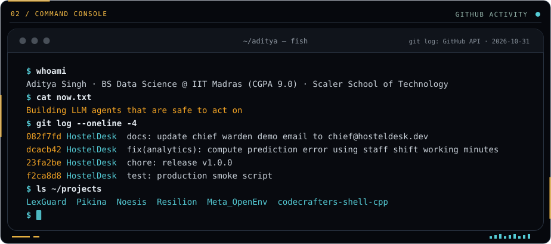

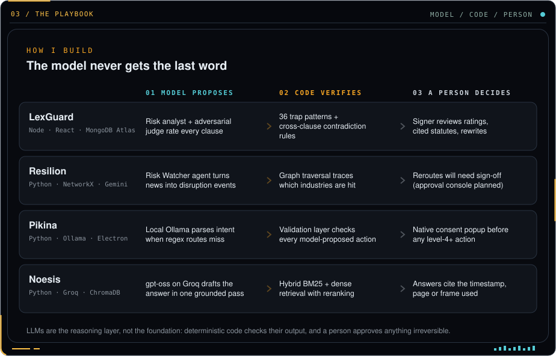


## Featured loadout

**Scope khol. Project pakad.** Pick a system and inspect the code.

**Choose your drop:** contract review, local agents, multimodal search, or supply-chain intelligence. Each card opens its repository.

<table>
<tr>
<td width="50%" valign="top">
<a href="https://github.com/Aditya2514/LexGuard"></a>

<b>Spot the trap before you sign.</b> Reviews contracts under Indian law using a staged agent pipeline, statutory retrieval and deterministic risk checks.

Node.js · React · MongoDB · Redis

<a href="https://github.com/Aditya2514/LexGuard"><b>Inspect LexGuard →</b></a>
</td>
<td width="50%" valign="top">
<a href="https://github.com/Aditya2514/Pikina"></a>

<b>Your machine. Your call.</b> An offline-first Windows/Linux assistant with regex-first routing, local Ollama, validated tools and consent for high-risk actions.

Python · Electron · Ollama · SQLite · Pre-alpha

<a href="https://github.com/Aditya2514/Pikina"><b>Inspect Pikina →</b></a>
</td>
</tr>
<tr>
<td width="50%" valign="top">
<a href="https://github.com/Aditya2514/Noesis"></a>

<b>Find the moment. Check the source.</b> Queries videos, audio, PDFs and images with hybrid retrieval, reranking and answers linked to timestamps or pages.

Python · ChromaDB · Whisper · Streamlit · Team project

<a href="https://github.com/Aditya2514/Noesis"><b>Inspect Noesis →</b></a>
</td>
<td width="50%" valign="top">
<a href="https://github.com/Aditya2514/Resilion"></a>

<b>Trace the ripple before it spreads.</b> A Risk Watcher turns news into structured events; a supply graph traces affected industries. Orchestration and the approval console are planned.

Python · NetworkX · Gemini · In progress

<a href="https://github.com/Aditya2514/Resilion"><b>Inspect Resilion →</b></a>
</td>
</tr>
</table>

<b>Open the engineering brief — what is underneath the visuals?</b>

- **LexGuard:** deterministic trap detection can escalate an LLM's risk assessment; retrieval grounds statutory citations. Its README includes benchmark context and limitations.
- **Pikina:** the action validator checks model proposals against registered capabilities. Alias chains support rollback; the scheduler still awaits its planner.
- **Noesis:** BM25 and dense retrieval feed a reranker; source citations and an LLM audit help inspect answers. Built with Apurva Patil.
- **Resilion:** the graph and Risk Watcher are built. Rerouting, the API and approval console remain future work.

The original animated project demonstrations above are preserved in full. Their sequences illustrate mechanisms; they are not live production runs.


## Utility belt

**Game wali utility. Builder wala purpose.** Click a utility to explore the project behind it.

<table>
<tr>
<td width="50%" valign="top"><a href="https://github.com/Aditya2514/Noesis"></a>
<b>Smoke daal. Noise hata.</b> Noesis brings useful evidence into focus.
</td>
<td width="50%" valign="top"><a href="https://github.com/Aditya2514/LexGuard"></a>
<b>Frag out. Bug out.</b> Inspect the checks behind LexGuard.
</td>
</tr>
<tr>
<td width="50%" valign="top"><a href="https://github.com/Aditya2514/codecrafters-shell-cpp"></a>
<b>Debt jalao. Clean build.</b> Get closer to the system with the C++ shell.
</td>
<td width="50%" valign="top"><a href="https://github.com/Aditya2514/HostelDesk"></a>
<b>Boost on. Build on.</b> Turn a real hostel problem into working software.
</td>
</tr>
</table>



## Mission replay


An illustrative contract run, preserved from the original profile.


## Project lobby

**Pick your next drop.** Each animated card opens its repository.

<!-- PROJECT-LOBBY:START -->

<a href="https://github.com/Aditya2514/HostelDesk">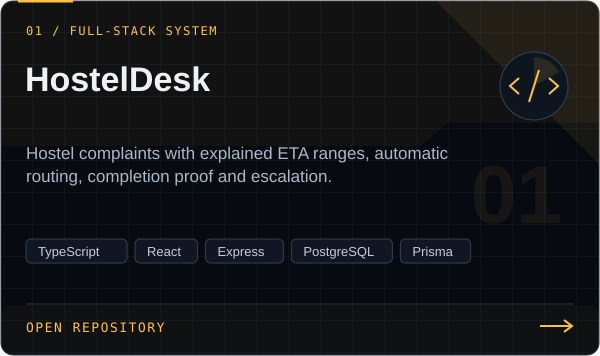</a>
<a href="https://github.com/Aditya2514/Meta_OpenEnv">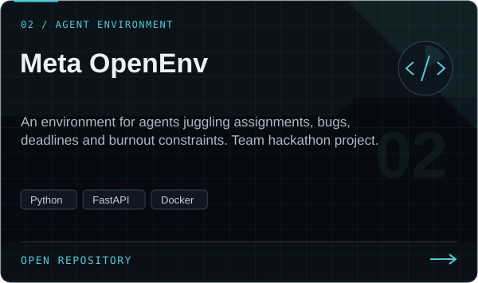</a>

<a href="https://github.com/Aditya2514/Shopkart">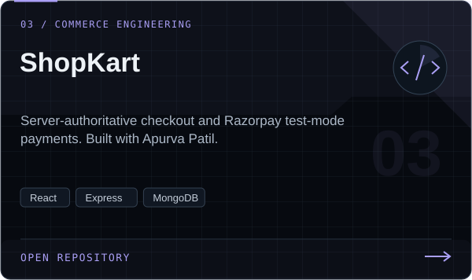</a>
<a href="https://github.com/Aditya2514/codecrafters-shell-cpp">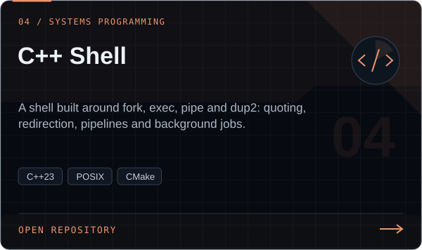</a>

<a href="https://github.com/Aditya2514/Vidya">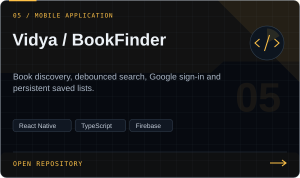</a>
<a href="https://github.com/Aditya2514/Fintrac">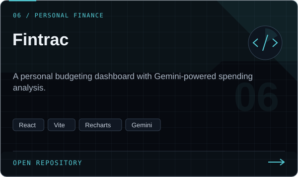</a>

<a href="https://github.com/Aditya2514/Naukri">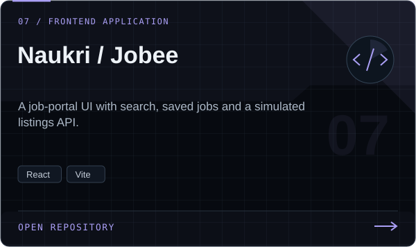</a>
<a href="https://github.com/Aditya2514/Mobius">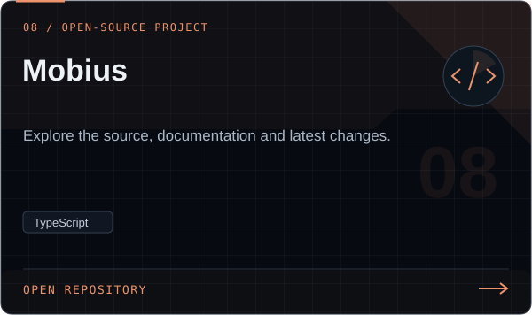</a>

<!-- PROJECT-LOBBY:END -->

Earlier experiments / archive

[FinancePro](https://github.com/Aditya2514/FinancePro) · [Simple Soundboard](https://github.com/Aditya2514/Simple-Sounboard) · [First portfolio](https://github.com/Aditya2514/portfolio)


## Match history


Actual GitHub activity. The existing workflow is scheduled to refresh this card every six hours; the card shows its last update.

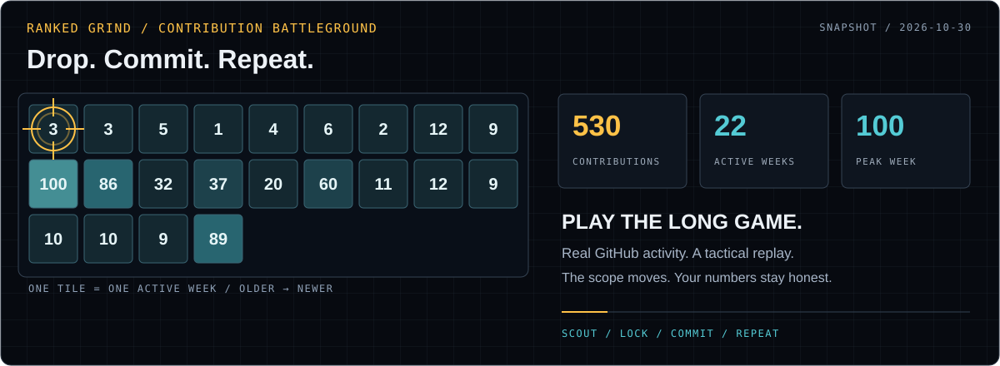

Each tile is an active week. The scope patrol is decorative; contribution values stay unchanged.


## Build kit

From local agents to full-stack apps: the tools behind my builds.

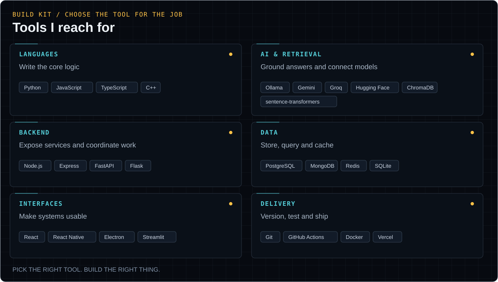


## Career campaign


| Education | Achievement |
| :-- | :-- |
| **IIT Madras** · BS Data Science & Applications · 2025–2029 · CGPA **9.0/10** | **Runner-up** · Paradox DSA Triathlon · IIT Madras · 2026 |
| **Scaler School of Technology** · 2025–2029 | **Meta PyTorch OpenEnv Hackathon** · 2026 · Team submission |


## Squad up


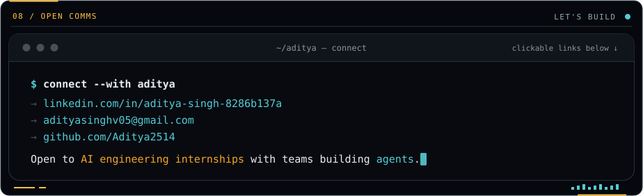

Interested in **AI engineering internships**, **agent systems**, or a **hackathon project**? Send me the problem you're working on. If you're here for the BGMI energy, tell me your favourite drop spot too.

<a href="https://www.linkedin.com/in/aditya-singh-8286b137a/"></a>
<a href="mailto:adityasinghv05@gmail.com"></a>
<a href="https://github.com/Aditya2514?tab=repositories"></a>

[LinkedIn](https://www.linkedin.com/in/aditya-singh-8286b137a/) · [Email](mailto:adityasinghv05@gmail.com) · [Repositories](https://github.com/Aditya2514?tab=repositories)


 
<b>GG. Now go inspect the code.</b> 
BGMI-inspired visuals. Built for curious people who click through to the code.

