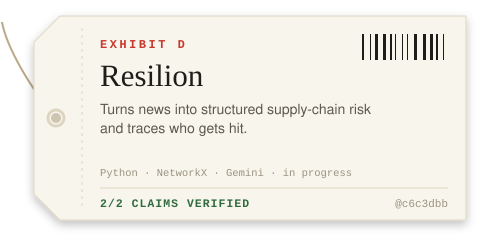
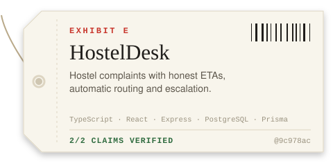

<picture>
  <source media="(max-width: 600px) and (prefers-color-scheme: light)" srcset="assets/proof/receipt-light-mobile.svg" />
  <source media="(max-width: 600px)" srcset="assets/proof/receipt-dark-mobile.svg" />
  <source media="(prefers-color-scheme: light)" srcset="assets/proof/receipt-light.svg" />
  
</picture>

<b><a href="#exhibits">Exhibits</a> &nbsp;·&nbsp; <a href="#the-ledger">The ledger</a> &nbsp;·&nbsp; <a href="#what-isnt-done-yet">What isn't done yet</a> &nbsp;·&nbsp; <a href="#contact">Contact</a></b>

I'm **Aditya Singh**. I study Data Science & Applications at **IIT Madras** and I'm co-enrolled at **Scaler School of Technology**. I build LLM systems, local desktop agents and full-stack products, and the part I care about most is **what happens when the model gets something wrong**.

My projects follow one rule: *the model proposes, the system checks, the person stays in control.* This page follows it too.

## How this page works

1. Each project is an **exhibit**.
2. Each exhibit makes a few specific claims, not adjectives.
3. Each claim links to the line of code that implements it, pinned to the commit that was read.
4. Every six hours a GitHub Action re-reads those lines. If the code moved or was deleted, the claim is marked **STALE** in public until I fix the code or the wording.

Nobody, me included, can quietly change what this page says about my code.

## Exhibits

<!-- LEDGER:START -->

### The ledger

| # | Claim | Evidence | Status |
| :-- | :-- | :-- | :-- |
| A1 | Deterministic rules run before any LLM agent reads a risk level, so the model cannot talk a clause down. | [`jobQueueService.js:107`](https://github.com/Aditya2514/LexGuard/blob/2e6cb460aa9efabc2a51d3aa3c7aaf02849169a5/backend/src/services/jobQueueService.js#L107) | **VERIFIED** |
| A2 | Every statute the model cites is looked up and graded before it is shown. | [`citationVerifier.js:404`](https://github.com/Aditya2514/LexGuard/blob/2e6cb460aa9efabc2a51d3aa3c7aaf02849169a5/backend/src/services/citationVerifier.js#L404) | **VERIFIED** |
| A3 | Rules copied from the benchmark's own text were deleted, even though they raised the score. | [`classifierService.js:134`](https://github.com/Aditya2514/LexGuard/blob/2e6cb460aa9efabc2a51d3aa3c7aaf02849169a5/backend/src/services/classifierService.js#L134) | **VERIFIED** |
| B1 | Nothing the model proposes reaches a tool without a schema check against the capability registry. | [`schema_check.py:10`](https://github.com/Aditya2514/Pikina/blob/4bcbcec85180db750df0844f2a55d34b2b016d21/src/pikina/validation/schema_check.py#L10) | **VERIFIED** |
| B2 | One consent rule for every path: level 4 always asks; level 3 asks when the action can't be rolled back. | [`gatekeeper.py:16`](https://github.com/Aditya2514/Pikina/blob/4bcbcec85180db750df0844f2a55d34b2b016d21/src/pikina/registry/gatekeeper.py#L16) | **VERIFIED** |
| B3 | Multi-step plans roll back step by step when one fails. | [`rollback_engine.py:15`](https://github.com/Aditya2514/Pikina/blob/4bcbcec85180db750df0844f2a55d34b2b016d21/src/pikina/transactions/rollback_engine.py#L15) | **VERIFIED** |
| C1 | Dense and BM25 results are merged with reciprocal rank fusion. | [`hybrid_retrieve.py:177`](https://github.com/Aditya2514/Noesis/blob/fde4e09283833cd25ec9e58777d0f6d74fa33bce/hybrid_retrieve.py#L177) | **VERIFIED** |
| C2 | Reranking runs on a local cross-encoder, not a paid API. | [`hybrid_retrieve.py:28`](https://github.com/Aditya2514/Noesis/blob/fde4e09283833cd25ec9e58777d0f6d74fa33bce/hybrid_retrieve.py#L28) | **VERIFIED** |
| D1 | The model can't invent a trade corridor: extracted events must name a seeded one, or none. | [`risk_agent.py:194`](https://github.com/Aditya2514/Resilion/blob/c6c3dbb3c883da1731f3ecaac6666d49ff75bf2e/backend/agents/risk_agent.py#L194) | **VERIFIED** |
| D2 | A disruption is traced through the supply graph to the industries it affects. | [`traversal.py:34`](https://github.com/Aditya2514/Resilion/blob/c6c3dbb3c883da1731f3ecaac6666d49ff75bf2e/backend/graph/traversal.py#L34) | **VERIFIED** |
| E1 | A late ticket tells the student why it is late, in plain words. | [`eta.service.ts:78`](https://github.com/Aditya2514/HostelDesk/blob/9c978ace415069e1f1f8b07e55d0869ec28b1260/server/src/modules/scheduling/eta.service.ts#L78) | **VERIFIED** |
| E2 | Missed deadlines escalate on a background job, with no one having to notice. | [`escalation.job.ts:21`](https://github.com/Aditya2514/HostelDesk/blob/9c978ace415069e1f1f8b07e55d0869ec28b1260/server/src/jobs/escalation.job.ts#L21) | **VERIFIED** |
| F1 | Pipelines are wired by hand with pipe() and fork(), not a library. | [`main.cpp:366`](https://github.com/Aditya2514/codecrafters-shell-cpp/blob/c4adda13d0f55a81f540b209b496a4cb087a1e1d/src/main.cpp#L366) | **VERIFIED** |
| F2 | Each stage's stdin is the previous stage's pipe, rewired with dup2(). | [`main.cpp:369`](https://github.com/Aditya2514/codecrafters-shell-cpp/blob/c4adda13d0f55a81f540b209b496a4cb087a1e1d/src/main.cpp#L369) | **VERIFIED** |
| F3 | Quoting is parsed by its own state machine for single and double quotes. | [`main.cpp:168`](https://github.com/Aditya2514/codecrafters-shell-cpp/blob/c4adda13d0f55a81f540b209b496a4cb087a1e1d/src/main.cpp#L168) | **VERIFIED** |

Audited 15 NOV 2026 16:06Z · 15 of 15 claims verified · each link is pinned to the commit that was read · rerun every six hours by <a href="scripts/build_proof.py"><code>scripts/build_proof.py</code></a>.

<!-- LEDGER:END -->

## What isn't done yet

A profile that lists only wins is hiding something. Here is what is unfinished:

- **Pikina** is pre-alpha. The task scheduler is built and tested, but nothing calls it yet; it is waiting for the planner.
- **Resilion** has the supply graph and the Risk Watcher working. Rerouting, the API and the approval console are still planned.
- **LexGuard** got *less* impressive on paper in October 2026: I removed two classifier rules whose triggers had been copied from the benchmark's own text. A rule that matches the test set measures memory, not judgement.
- **Noesis** and **ShopKart** were built with **Apurva Patil**. The claims above are about the code, not about who typed which line.

## Also on file

[ShopKart](https://github.com/Aditya2514/Shopkart): server-authoritative checkout with Razorpay test-mode payments ·
[Meta OpenEnv](https://github.com/Aditya2514/Meta_OpenEnv): an agent environment of assignments, bugs, deadlines and burnout (team hackathon) ·
[Vidya](https://github.com/Aditya2514/Vidya): book discovery in React Native ·
[Fintrac](https://github.com/Aditya2514/Fintrac): budgeting with Gemini spending analysis ·
[everything else](https://github.com/Aditya2514?tab=repositories)

## Record

| Education | Achievement |
| :-- | :-- |
| **IIT Madras** · BS Data Science & Applications · 2025–2029 · CGPA **9.0/10** | **Runner-up** · Paradox DSA Triathlon · IIT Madras · 2026 |
| **Scaler School of Technology** · 2025–2029 | **Meta PyTorch OpenEnv Hackathon** · 2026 · team submission |

## Contact

Looking for **AI engineering internships**, **agent systems** work, or a **hackathon team**. Send me the problem, and I'll send you line numbers.

**[LinkedIn ↗](https://www.linkedin.com/in/aditya-singh-8286b137a/)** &nbsp;·&nbsp; **[Email ↗](mailto:adityasinghv05@gmail.com)** &nbsp;·&nbsp; **[All repositories ↗](https://github.com/Aditya2514?tab=repositories)**

✂ - - - - - - - - - - - - - - - - - - - - - - - - - - - - - - - - - - - - - - - - - - - - - - - - - - - - - - - Keep this receipt. Diff it later.

