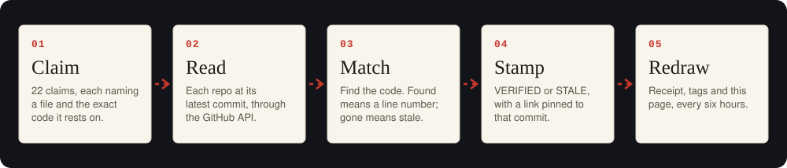
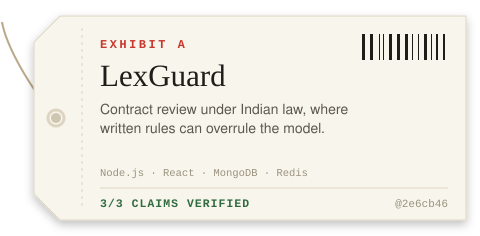
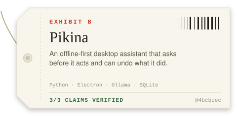
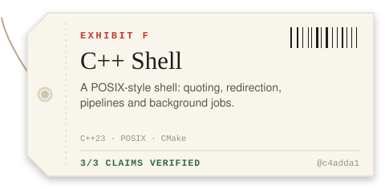
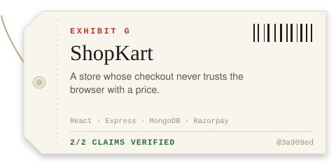
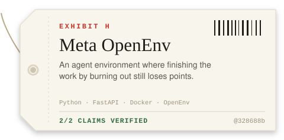

<picture>
  <source media="(max-width: 600px) and (prefers-color-scheme: light)" srcset="assets/proof/receipt-light-mobile.svg" />
  <source media="(max-width: 600px)" srcset="assets/proof/receipt-dark-mobile.svg" />
  <source media="(prefers-color-scheme: light)" srcset="assets/proof/receipt-light.svg" />
  
</picture>

<b><a href="#how-this-page-works">How it works</a> &nbsp;·&nbsp; <a href="#exhibits">Exhibits</a> &nbsp;·&nbsp; <a href="#case-files">Case files</a> &nbsp;·&nbsp; <a href="#the-ledger">Ledger</a> &nbsp;·&nbsp; <a href="#principles-with-receipts">Principles</a> &nbsp;·&nbsp; <a href="#whats-next">Next</a> &nbsp;·&nbsp; <a href="#contact">Contact</a></b>

## Hi, I'm Aditya

I study **Data Science & Applications at IIT Madras** and I'm co-enrolled at **Scaler School of Technology**. I build LLM systems, local desktop agents and full-stack products.

The part I care about most is **what happens when the model gets something wrong**. A model that is right most of the time is easy to demo and hard to trust, so most of my work goes into the layer around it: rules that can overrule it, retrieval that keeps it honest, consent before it acts, and a way to undo what it did.

My projects follow one rule: *the model proposes, the system checks, the person stays in control.* This page follows that rule too.

## How this page works

<picture>
  <source media="(max-width: 600px) and (prefers-color-scheme: light)" srcset="assets/proof/pipeline-light-mobile.svg" />
  <source media="(max-width: 600px)" srcset="assets/proof/pipeline-dark-mobile.svg" />
  <source media="(prefers-color-scheme: light)" srcset="assets/proof/pipeline-light.svg" />
  
</picture>

1. Each project is an **exhibit**, and each exhibit makes a few specific claims, not adjectives.
2. Each claim names a file and the exact code it rests on, in [`data/claims.json`](data/claims.json).
3. Every six hours a GitHub Action reads that file at the repository's latest commit with [`scripts/build_proof.py`](scripts/build_proof.py).
4. If the code is there, the claim is **VERIFIED** and links to the line, pinned to that commit. If it moved or was deleted, the claim turns **STALE** on this page until I fix the code or the wording.

Nobody, me included, can quietly change what this page says about my code.

<!-- LEDGER:START -->

## Exhibits

8 projects, 22 claims. Each tag opens the repository; each claim ID opens the line.

## Case files

Open any file for the problem, the approach, what was hard and what is unfinished.

<b>Exhibit A · LexGuard</b> &nbsp;·&nbsp; Contract review under Indian law, where written rules can overrule the model. &nbsp;<code>4/4 verified</code>

**The problem.** A contract reviewer that is right most of the time is easy to demo and hard to trust. LLMs under-rate predatory clauses written in calm legal language: the trap reads as boilerplate, so it comes back LOW.

**The approach.** A staged agent pipeline extracts clauses, rates risk, checks Indian statutes and drafts rewrites. Before any of those agents reads a risk level, a deterministic auditor runs hand-written trap patterns and can force an escalation. Every statute the model cites is looked up and graded before the user sees it.

**What was hard.**

- Fitting in 512 MB of RAM: a 380 MB V8 heap cap, local embedding models unloaded when idle, and a forced GC after every job.
- Providers fail mid-document, so the AI client falls through Gemini, Groq, Hugging Face, Grok and local Ollama instead of failing the job.
- PDFs glue section numbers onto the previous sentence. A two-pass chunker repairs the text before any model sees it.
- Clause IDs echoed back by the LLM drifted onto the wrong clause, so clauses are keyed by their position in the document instead.

**Claims.**

- [`A1`](https://github.com/Aditya2514/LexGuard/blob/2e6cb460aa9efabc2a51d3aa3c7aaf02849169a5/backend/src/services/jobQueueService.js#L107) Deterministic rules run before any LLM agent reads a risk level, so the model cannot talk a clause down.
- [`A2`](https://github.com/Aditya2514/LexGuard/blob/2e6cb460aa9efabc2a51d3aa3c7aaf02849169a5/backend/src/services/citationVerifier.js#L404) Every statute the model cites is looked up and graded before it is shown.
- [`A3`](https://github.com/Aditya2514/LexGuard/blob/2e6cb460aa9efabc2a51d3aa3c7aaf02849169a5/backend/src/services/classifierService.js#L134) Rules copied from the benchmark's own text were deleted, even though they raised the score.
- [`A4`](https://github.com/Aditya2514/LexGuard/blob/2e6cb460aa9efabc2a51d3aa3c7aaf02849169a5/backend/package.json#L8) The backend is sized for a 512 MB host: the V8 heap is capped at 380 MB.

**Not done yet.** The committed benchmark reports were run before I removed rules copied from the benchmark, so they may overstate current accuracy; a re-run is pending. I also wrote both the test clauses and the trap patterns, so the suites catch regressions, not generalisation.

Node.js · React · MongoDB · Redis · [Open the repository →](https://github.com/Aditya2514/LexGuard)

<b>Exhibit B · Pikina</b> &nbsp;·&nbsp; An offline-first desktop assistant that asks before it acts and can undo what it did. &nbsp;<code>3/3 verified</code>

**The problem.** An assistant that can touch your files and apps is only useful if you can see, and stop, what it is about to do. Most assistants send your screen to a server and act first.

**The approach.** Known intents go through regex-first routing; everything else goes to a local model through Ollama. Every action the model proposes is checked against a capability registry, passes one shared consent rule, and multi-step plans run as transactions that roll back when a step fails.

**What was hard.**

- Keeping one consent rule true across three entry points (hotkey, local model and API), so no path can skip the gate.
- Making rollback real: an action is only allowed to run unattended at level 3 if it declares how to undo itself.

**Claims.**

- [`B1`](https://github.com/Aditya2514/Pikina/blob/4bcbcec85180db750df0844f2a55d34b2b016d21/src/pikina/validation/schema_check.py#L10) Nothing the model proposes reaches a tool without a schema check against the capability registry.
- [`B2`](https://github.com/Aditya2514/Pikina/blob/4bcbcec85180db750df0844f2a55d34b2b016d21/src/pikina/registry/gatekeeper.py#L16) One consent rule for every path: level 4 always asks; level 3 asks when the action can't be rolled back.
- [`B3`](https://github.com/Aditya2514/Pikina/blob/4bcbcec85180db750df0844f2a55d34b2b016d21/src/pikina/transactions/rollback_engine.py#L15) Multi-step plans roll back step by step when one fails.

**Not done yet.** Pre-alpha. The task scheduler is built and tested, but nothing calls it until the planner lands.

Python · Electron · Ollama · SQLite · [Open the repository →](https://github.com/Aditya2514/Pikina)

<b>Exhibit C · Noesis</b> &nbsp;·&nbsp; Search across video, audio, PDFs and images, with answers pinned to a timestamp or page. &nbsp;<code>4/4 verified</code>

**The problem.** Text-only RAG misses what is said in a lecture video or drawn on a slide, and an answer with no timestamp or page number can't be checked.

**The approach.** Video, audio, PDFs and images are turned into one chunk schema with a time window or page attached. Retrieval fuses dense and BM25 results, a local cross-encoder reranks them, and a separate fact-audit pass labels every claim in the answer supported, partially supported or unsupported.

**What was hard.**

- Exact terms (names, formulas, error codes) get lost by embeddings, and paraphrases get lost by BM25, so it needs both, fused.
- A grounded answer is only checkable if each chunk remembers where it came from, so location is part of the schema, not an afterthought.

**Claims.**

- [`C1`](https://github.com/Aditya2514/Noesis/blob/fde4e09283833cd25ec9e58777d0f6d74fa33bce/hybrid_retrieve.py#L177) Dense and BM25 results are merged with reciprocal rank fusion.
- [`C2`](https://github.com/Aditya2514/Noesis/blob/fde4e09283833cd25ec9e58777d0f6d74fa33bce/hybrid_retrieve.py#L28) Reranking runs on a local cross-encoder, not a paid API.
- [`C3`](https://github.com/Aditya2514/Noesis/blob/fde4e09283833cd25ec9e58777d0f6d74fa33bce/grounded_generate.py#L205) A second pass audits every claim in the answer as supported, partially supported or unsupported.
- [`C4`](https://github.com/Aditya2514/Noesis/blob/fde4e09283833cd25ec9e58777d0f6d74fa33bce/grounded_generate.py#L98) Every source is cited by its time window in a recording or its page in a document.

**Not done yet.** Built with Apurva Patil as a Streamlit prototype; it has not been run on a large corpus.

Python · ChromaDB · Whisper · Streamlit · [Open the repository →](https://github.com/Aditya2514/Noesis)

<b>Exhibit D · Resilion</b> &nbsp;·&nbsp; Turns news into structured supply-chain risk and traces who gets hit. &nbsp;<code>2/2 verified</code>

**The problem.** Supply-chain risk shows up as news prose. Deciding which industries a port closure or a strike actually affects needs structure, not a summary.

**The approach.** Gemini extracts structured risk events from articles; validators reject any event type, severity or trade corridor the graph doesn't know. Graph traversal then finds the industries downstream of the disruption and scores how exposed each one is.

**What was hard.**

- Stopping the model from inventing places: an extracted corridor must already exist in the seeded graph, or the field stays empty.

**Claims.**

- [`D1`](https://github.com/Aditya2514/Resilion/blob/c6c3dbb3c883da1731f3ecaac6666d49ff75bf2e/backend/agents/risk_agent.py#L194) The model can't invent a trade corridor: extracted events must name a seeded one, or none.
- [`D2`](https://github.com/Aditya2514/Resilion/blob/c6c3dbb3c883da1731f3ecaac6666d49ff75bf2e/backend/graph/traversal.py#L34) A disruption is traced through the supply graph to the industries it affects.

**Not done yet.** The supply graph and the Risk Watcher work. Rerouting, the API and the approval console are planned, not built.

Python · NetworkX · Gemini · [Open the repository →](https://github.com/Aditya2514/Resilion)

<b>Exhibit E · HostelDesk</b> &nbsp;·&nbsp; Hostel complaints with honest ETAs, automatic routing and escalation. &nbsp;<code>2/2 verified</code>

**The problem.** Hostel complaints vanish into a queue with no date and no reason. Students chase staff; staff can't see their own backlog.

**The approach.** Tickets are routed to the right staff member automatically. Each staff queue is simulated to produce an ETA range, a delay comes with a plain-language reason, and a background job escalates anything past its deadline.

**What was hard.**

- An ETA is only honest if it accounts for everything already in that person's queue, so ETAs come from simulating the whole queue, not a fixed SLA.

**Claims.**

- [`E1`](https://github.com/Aditya2514/HostelDesk/blob/9c978ace415069e1f1f8b07e55d0869ec28b1260/server/src/modules/scheduling/eta.service.ts#L78) A late ticket tells the student why it is late, in plain words.
- [`E2`](https://github.com/Aditya2514/HostelDesk/blob/9c978ace415069e1f1f8b07e55d0869ec28b1260/server/src/jobs/escalation.job.ts#L21) Missed deadlines escalate on a background job, with no one having to notice.

**Not done yet.** Deployed on Neon and Render. The ML features on its roadmap are planned, not built.

TypeScript · React · Express · PostgreSQL · Prisma · [Open the repository →](https://github.com/Aditya2514/HostelDesk)

<b>Exhibit F · C++ Shell</b> &nbsp;·&nbsp; A POSIX-style shell: quoting, redirection, pipelines and background jobs. &nbsp;<code>3/3 verified</code>

**The problem.** The shell is the tool everyone uses and few people have built. I wanted to know what actually happens between pressing Enter and seeing output.

**The approach.** Builtins, PATH lookup, a quoting state machine, I/O redirection, multi-stage pipelines and background jobs, built directly on fork, exec, pipe and dup2.

**What was hard.**

- File descriptors: every pipe end a child doesn't use has to be closed, or the next stage waits forever for an EOF that never comes.

**Claims.**

- [`F1`](https://github.com/Aditya2514/codecrafters-shell-cpp/blob/c4adda13d0f55a81f540b209b496a4cb087a1e1d/src/main.cpp#L366) Pipelines are wired by hand with pipe() and fork(), not a library.
- [`F2`](https://github.com/Aditya2514/codecrafters-shell-cpp/blob/c4adda13d0f55a81f540b209b496a4cb087a1e1d/src/main.cpp#L369) Each stage's stdin is the previous stage's pipe, rewired with dup2().
- [`F3`](https://github.com/Aditya2514/codecrafters-shell-cpp/blob/c4adda13d0f55a81f540b209b496a4cb087a1e1d/src/main.cpp#L168) Quoting is parsed by its own state machine for single and double quotes.

**Not done yet.** Built along the CodeCrafters shell track, so the feature list follows its stages.

C++23 · POSIX · CMake · [Open the repository →](https://github.com/Aditya2514/codecrafters-shell-cpp)

<b>Exhibit G · ShopKart</b> &nbsp;·&nbsp; A store whose checkout never trusts the browser with a price. &nbsp;<code>2/2 verified</code>

**The problem.** A checkout that trusts the price the browser sends can be edited into a discount, and a payment the client says succeeded may not have.

**The approach.** The server rebuilds every order from database prices and live stock, and an order is only marked paid after Razorpay's signature checks out with HMAC-SHA256 on the server.

**Claims.**

- [`G1`](https://github.com/Aditya2514/Shopkart/blob/3a909ed607c55817e66ba5d623886d44ea2e0460/server/controllers/order.controller.js#L71) Order totals are recomputed on the server from database prices; the client's total is ignored.
- [`G2`](https://github.com/Aditya2514/Shopkart/blob/3a909ed607c55817e66ba5d623886d44ea2e0460/server/controllers/order.controller.js#L171) A payment counts only after its Razorpay signature is verified with HMAC-SHA256.

**Not done yet.** Razorpay runs in test mode. Built with Apurva Patil.

React · Express · MongoDB · Razorpay · [Open the repository →](https://github.com/Aditya2514/Shopkart)

<b>Exhibit H · Meta OpenEnv</b> &nbsp;·&nbsp; An agent environment where finishing the work by burning out still loses points. &nbsp;<code>2/2 verified</code>

**The problem.** Agent benchmarks reward getting things done. Few of them penalise an agent for scheduling a person into the ground to do it.

**The approach.** An OpenEnv environment where an agent plans assignments, bugs and features against hard deadlines. The graders reward finished work and add bonuses only for burnout-free (no day over 8 hours) and balanced schedules.

**Claims.**

- [`H1`](https://github.com/Aditya2514/Meta_OpenEnv/blob/328688b03ec3310cf8498f83ad6fd8dd7e1b00f6/src/envs/assignment_planner/environment.py#L106) The environment follows the standard step contract: observation, reward, done, info.
- [`H2`](https://github.com/Aditya2514/Meta_OpenEnv/blob/328688b03ec3310cf8498f83ad6fd8dd7e1b00f6/src/envs/assignment_planner/graders.py#L190) A schedule only counts as burnout-free if no day goes past 8 hours.

**Not done yet.** A team submission to the Meta PyTorch OpenEnv Hackathon.

Python · FastAPI · Docker · OpenEnv · [Open the repository →](https://github.com/Aditya2514/Meta_OpenEnv)

## The ledger

| # | Claim | Evidence | Status |
| :-- | :-- | :-- | :-- |
| A1 | Deterministic rules run before any LLM agent reads a risk level, so the model cannot talk a clause down. | [`jobQueueService.js:107`](https://github.com/Aditya2514/LexGuard/blob/2e6cb460aa9efabc2a51d3aa3c7aaf02849169a5/backend/src/services/jobQueueService.js#L107) | **VERIFIED** |
| A2 | Every statute the model cites is looked up and graded before it is shown. | [`citationVerifier.js:404`](https://github.com/Aditya2514/LexGuard/blob/2e6cb460aa9efabc2a51d3aa3c7aaf02849169a5/backend/src/services/citationVerifier.js#L404) | **VERIFIED** |
| A3 | Rules copied from the benchmark's own text were deleted, even though they raised the score. | [`classifierService.js:134`](https://github.com/Aditya2514/LexGuard/blob/2e6cb460aa9efabc2a51d3aa3c7aaf02849169a5/backend/src/services/classifierService.js#L134) | **VERIFIED** |
| A4 | The backend is sized for a 512 MB host: the V8 heap is capped at 380 MB. | [`package.json:8`](https://github.com/Aditya2514/LexGuard/blob/2e6cb460aa9efabc2a51d3aa3c7aaf02849169a5/backend/package.json#L8) | **VERIFIED** |
| B1 | Nothing the model proposes reaches a tool without a schema check against the capability registry. | [`schema_check.py:10`](https://github.com/Aditya2514/Pikina/blob/4bcbcec85180db750df0844f2a55d34b2b016d21/src/pikina/validation/schema_check.py#L10) | **VERIFIED** |
| B2 | One consent rule for every path: level 4 always asks; level 3 asks when the action can't be rolled back. | [`gatekeeper.py:16`](https://github.com/Aditya2514/Pikina/blob/4bcbcec85180db750df0844f2a55d34b2b016d21/src/pikina/registry/gatekeeper.py#L16) | **VERIFIED** |
| B3 | Multi-step plans roll back step by step when one fails. | [`rollback_engine.py:15`](https://github.com/Aditya2514/Pikina/blob/4bcbcec85180db750df0844f2a55d34b2b016d21/src/pikina/transactions/rollback_engine.py#L15) | **VERIFIED** |
| C1 | Dense and BM25 results are merged with reciprocal rank fusion. | [`hybrid_retrieve.py:177`](https://github.com/Aditya2514/Noesis/blob/fde4e09283833cd25ec9e58777d0f6d74fa33bce/hybrid_retrieve.py#L177) | **VERIFIED** |
| C2 | Reranking runs on a local cross-encoder, not a paid API. | [`hybrid_retrieve.py:28`](https://github.com/Aditya2514/Noesis/blob/fde4e09283833cd25ec9e58777d0f6d74fa33bce/hybrid_retrieve.py#L28) | **VERIFIED** |
| C3 | A second pass audits every claim in the answer as supported, partially supported or unsupported. | [`grounded_generate.py:205`](https://github.com/Aditya2514/Noesis/blob/fde4e09283833cd25ec9e58777d0f6d74fa33bce/grounded_generate.py#L205) | **VERIFIED** |
| C4 | Every source is cited by its time window in a recording or its page in a document. | [`grounded_generate.py:98`](https://github.com/Aditya2514/Noesis/blob/fde4e09283833cd25ec9e58777d0f6d74fa33bce/grounded_generate.py#L98) | **VERIFIED** |
| D1 | The model can't invent a trade corridor: extracted events must name a seeded one, or none. | [`risk_agent.py:194`](https://github.com/Aditya2514/Resilion/blob/c6c3dbb3c883da1731f3ecaac6666d49ff75bf2e/backend/agents/risk_agent.py#L194) | **VERIFIED** |
| D2 | A disruption is traced through the supply graph to the industries it affects. | [`traversal.py:34`](https://github.com/Aditya2514/Resilion/blob/c6c3dbb3c883da1731f3ecaac6666d49ff75bf2e/backend/graph/traversal.py#L34) | **VERIFIED** |
| E1 | A late ticket tells the student why it is late, in plain words. | [`eta.service.ts:78`](https://github.com/Aditya2514/HostelDesk/blob/9c978ace415069e1f1f8b07e55d0869ec28b1260/server/src/modules/scheduling/eta.service.ts#L78) | **VERIFIED** |
| E2 | Missed deadlines escalate on a background job, with no one having to notice. | [`escalation.job.ts:21`](https://github.com/Aditya2514/HostelDesk/blob/9c978ace415069e1f1f8b07e55d0869ec28b1260/server/src/jobs/escalation.job.ts#L21) | **VERIFIED** |
| F1 | Pipelines are wired by hand with pipe() and fork(), not a library. | [`main.cpp:366`](https://github.com/Aditya2514/codecrafters-shell-cpp/blob/c4adda13d0f55a81f540b209b496a4cb087a1e1d/src/main.cpp#L366) | **VERIFIED** |
| F2 | Each stage's stdin is the previous stage's pipe, rewired with dup2(). | [`main.cpp:369`](https://github.com/Aditya2514/codecrafters-shell-cpp/blob/c4adda13d0f55a81f540b209b496a4cb087a1e1d/src/main.cpp#L369) | **VERIFIED** |
| F3 | Quoting is parsed by its own state machine for single and double quotes. | [`main.cpp:168`](https://github.com/Aditya2514/codecrafters-shell-cpp/blob/c4adda13d0f55a81f540b209b496a4cb087a1e1d/src/main.cpp#L168) | **VERIFIED** |
| G1 | Order totals are recomputed on the server from database prices; the client's total is ignored. | [`order.controller.js:71`](https://github.com/Aditya2514/Shopkart/blob/3a909ed607c55817e66ba5d623886d44ea2e0460/server/controllers/order.controller.js#L71) | **VERIFIED** |
| G2 | A payment counts only after its Razorpay signature is verified with HMAC-SHA256. | [`order.controller.js:171`](https://github.com/Aditya2514/Shopkart/blob/3a909ed607c55817e66ba5d623886d44ea2e0460/server/controllers/order.controller.js#L171) | **VERIFIED** |
| H1 | The environment follows the standard step contract: observation, reward, done, info. | [`environment.py:106`](https://github.com/Aditya2514/Meta_OpenEnv/blob/328688b03ec3310cf8498f83ad6fd8dd7e1b00f6/src/envs/assignment_planner/environment.py#L106) | **VERIFIED** |
| H2 | A schedule only counts as burnout-free if no day goes past 8 hours. | [`graders.py:190`](https://github.com/Aditya2514/Meta_OpenEnv/blob/328688b03ec3310cf8498f83ad6fd8dd7e1b00f6/src/envs/assignment_planner/graders.py#L190) | **VERIFIED** |

Audited 15 NOV 2026 16:15Z · 22 of 22 claims verified · each link is pinned to the commit that was read.

## Principles, with receipts

Opinions are cheap, so each one links to the code where I acted on it.

**1. Rules decide what must never be wrong. Models handle the rest.** A language model is a good first reader and a bad final judge. When a mistake is expensive, a plain rule gets the last word. &nbsp;→ [`A1`](https://github.com/Aditya2514/LexGuard/blob/2e6cb460aa9efabc2a51d3aa3c7aaf02849169a5/backend/src/services/jobQueueService.js#L107) · [`D1`](https://github.com/Aditya2514/Resilion/blob/c6c3dbb3c883da1731f3ecaac6666d49ff75bf2e/backend/agents/risk_agent.py#L194)

**2. Ask before anything you can't undo.** Consent is cheap when it is rare. If an action can be rolled back, let it run; if it can't, stop and ask. &nbsp;→ [`B2`](https://github.com/Aditya2514/Pikina/blob/4bcbcec85180db750df0844f2a55d34b2b016d21/src/pikina/registry/gatekeeper.py#L16) · [`B3`](https://github.com/Aditya2514/Pikina/blob/4bcbcec85180db750df0844f2a55d34b2b016d21/src/pikina/transactions/rollback_engine.py#L15)

**3. Every answer points to its source.** A citation that can't be opened is decoration. Statutes are looked up, and answers point to a page or a timestamp. &nbsp;→ [`A2`](https://github.com/Aditya2514/LexGuard/blob/2e6cb460aa9efabc2a51d3aa3c7aaf02849169a5/backend/src/services/citationVerifier.js#L404) · [`C3`](https://github.com/Aditya2514/Noesis/blob/fde4e09283833cd25ec9e58777d0f6d74fa33bce/grounded_generate.py#L205) · [`C4`](https://github.com/Aditya2514/Noesis/blob/fde4e09283833cd25ec9e58777d0f6d74fa33bce/grounded_generate.py#L98)

**4. Don't grade yourself on the test you wrote.** A rule that matches the benchmark measures memory, not judgement. I deleted those rules and the score came with them. &nbsp;→ [`A3`](https://github.com/Aditya2514/LexGuard/blob/2e6cb460aa9efabc2a51d3aa3c7aaf02849169a5/backend/src/services/classifierService.js#L134)

**5. Never trust the client with money.** Prices come from the database and payments from a verified signature. The browser only gets to ask. &nbsp;→ [`G1`](https://github.com/Aditya2514/Shopkart/blob/3a909ed607c55817e66ba5d623886d44ea2e0460/server/controllers/order.controller.js#L71) · [`G2`](https://github.com/Aditya2514/Shopkart/blob/3a909ed607c55817e66ba5d623886d44ea2e0460/server/controllers/order.controller.js#L171)

**6. Tell people why, not just when.** A date with no reason creates follow-up messages. A reason makes waiting easier. &nbsp;→ [`E1`](https://github.com/Aditya2514/HostelDesk/blob/9c978ace415069e1f1f8b07e55d0869ec28b1260/server/src/modules/scheduling/eta.service.ts#L78) · [`E2`](https://github.com/Aditya2514/HostelDesk/blob/9c978ace415069e1f1f8b07e55d0869ec28b1260/server/src/jobs/escalation.job.ts#L21)

**7. Build the boring layer by hand at least once.** You understand a pipe after you have leaked one. &nbsp;→ [`F1`](https://github.com/Aditya2514/codecrafters-shell-cpp/blob/c4adda13d0f55a81f540b209b496a4cb087a1e1d/src/main.cpp#L366) · [`F2`](https://github.com/Aditya2514/codecrafters-shell-cpp/blob/c4adda13d0f55a81f540b209b496a4cb087a1e1d/src/main.cpp#L369)

## Latest receipts

The most recent changes across the exhibits, read during the last audit.

| Date | Project | Change |
| :-- | :-- | :-- |
| 2026‑10‑27 | [HostelDesk](https://github.com/Aditya2514/HostelDesk) | [docs: make the roadmap visual with three animated diagrams](https://github.com/Aditya2514/HostelDesk/commit/9c978ace415069e1f1f8b07e55d0869ec28b1260) |
| 2026‑10‑27 | [HostelDesk](https://github.com/Aditya2514/HostelDesk) | [docs: add roadmap of planned ML/AI features](https://github.com/Aditya2514/HostelDesk/commit/69b943303620719421c571856ace0a826acbf1e5) |
| 2026‑10‑22 | [Pikina](https://github.com/Aditya2514/Pikina) | [fix(switcher): review findings — Ctrl+C, git config execution, robustness](https://github.com/Aditya2514/Pikina/commit/21e6e432e8653851d9680c458f8814e7e942b6e9) |
| 2026‑10‑22 | [Pikina](https://github.com/Aditya2514/Pikina) | [feat: project switcher ("work on &lt;project&gt;") as the built-in workspace plugin](https://github.com/Aditya2514/Pikina/commit/a1b73fa721aaa649689d0b1412fa3d13e56c6f09) |
| 2026‑10‑21 | [Resilion](https://github.com/Aditya2514/Resilion) | [docs: separate what Resilion does today from what is planned](https://github.com/Aditya2514/Resilion/commit/c6c3dbb3c883da1731f3ecaac6666d49ff75bf2e) |
| 2026‑10‑21 | [Noesis](https://github.com/Aditya2514/Noesis) | [chore: remove unreferenced AI-generated concept images](https://github.com/Aditya2514/Noesis/commit/fde4e09283833cd25ec9e58777d0f6d74fa33bce) |
| 2026‑10‑21 | [Noesis](https://github.com/Aditya2514/Noesis) | [docs: match the README to the code](https://github.com/Aditya2514/Noesis/commit/9a577ee07c7c357d248b7fc14ad0b2b217ffd6e7) |
| 2026‑10‑21 | [LexGuard](https://github.com/Aditya2514/LexGuard) | [docs: align the README with the code](https://github.com/Aditya2514/LexGuard/commit/2e6cb460aa9efabc2a51d3aa3c7aaf02849169a5) |
| 2026‑10‑21 | [LexGuard](https://github.com/Aditya2514/LexGuard) | [chore: move one-off dev scripts and fixtures out of backend/ into scripts/dev](https://github.com/Aditya2514/LexGuard/commit/51ab388ddf1ef0df12add698b68840c220b4716c) |
| 2026‑10‑16 | [C++ Shell](https://github.com/Aditya2514/codecrafters-shell-cpp) | [docs: replace the CodeCrafters template README with what this shell does](https://github.com/Aditya2514/codecrafters-shell-cpp/commit/c4adda13d0f55a81f540b209b496a4cb087a1e1d) |

## What isn't done yet

A profile that lists only wins is hiding something. Here is what is unfinished or easy to overstate:

- **LexGuard:** The committed benchmark reports were run before I removed rules copied from the benchmark, so they may overstate current accuracy; a re-run is pending. I also wrote both the test clauses and the trap patterns, so the suites catch regressions, not generalisation.
- **Pikina:** Pre-alpha. The task scheduler is built and tested, but nothing calls it until the planner lands.
- **Noesis:** Built with Apurva Patil as a Streamlit prototype; it has not been run on a large corpus.
- **Resilion:** The supply graph and the Risk Watcher work. Rerouting, the API and the approval console are planned, not built.
- **HostelDesk:** Deployed on Neon and Render. The ML features on its roadmap are planned, not built.
- **C++ Shell:** Built along the CodeCrafters shell track, so the feature list follows its stages.
- **ShopKart:** Razorpay runs in test mode. Built with Apurva Patil.
- **Meta OpenEnv:** A team submission to the Meta PyTorch OpenEnv Hackathon.

## Toolbox, with receipts

Only tools I have shipped something with, and where.

| Tool | Used in |
| :-- | :-- |
| Python | [Pikina](https://github.com/Aditya2514/Pikina) · [Noesis](https://github.com/Aditya2514/Noesis) · [Resilion](https://github.com/Aditya2514/Resilion) · [Meta OpenEnv](https://github.com/Aditya2514/Meta_OpenEnv) |
| JavaScript · Node.js · Express | [LexGuard](https://github.com/Aditya2514/LexGuard) · [ShopKart](https://github.com/Aditya2514/Shopkart) |
| TypeScript | [HostelDesk](https://github.com/Aditya2514/HostelDesk) |
| React | [LexGuard](https://github.com/Aditya2514/LexGuard) · [HostelDesk](https://github.com/Aditya2514/HostelDesk) · [ShopKart](https://github.com/Aditya2514/Shopkart) |
| C++23 · POSIX | [C++ Shell](https://github.com/Aditya2514/codecrafters-shell-cpp) |
| Retrieval: BM25, dense vectors, RRF, cross-encoder reranking | [Noesis](https://github.com/Aditya2514/Noesis) · [LexGuard](https://github.com/Aditya2514/LexGuard) |
| Local inference: Ollama | [Pikina](https://github.com/Aditya2514/Pikina) · [LexGuard](https://github.com/Aditya2514/LexGuard) |
| Graphs: NetworkX | [Resilion](https://github.com/Aditya2514/Resilion) |
| MongoDB · Redis | [LexGuard](https://github.com/Aditya2514/LexGuard) · [ShopKart](https://github.com/Aditya2514/Shopkart) |
| PostgreSQL · Prisma | [HostelDesk](https://github.com/Aditya2514/HostelDesk) |
| SQLite · ChromaDB | [Pikina](https://github.com/Aditya2514/Pikina) · [Noesis](https://github.com/Aditya2514/Noesis) |
| FastAPI · Docker | [Meta OpenEnv](https://github.com/Aditya2514/Meta_OpenEnv) |

<!-- LEDGER:END -->

## What's next

Taken from the unfinished work above, in the order I intend to do it:

- **LexGuard:** re-run the benchmarks without the removed rules, then build a held-out set of real contracts I didn't write.
- **Pikina:** the planner, so the scheduler that's already built and tested finally has a caller.
- **Resilion:** rerouting suggestions, then an approval console so a person signs off on them.
- **Open source:** my first pull requests to projects other people maintain.

## Record

| Education | Achievement |
| :-- | :-- |
| **IIT Madras** · BS Data Science & Applications · 2025–2029 · CGPA **9.0/10** | **Runner-up** · Paradox DSA Triathlon · IIT Madras · 2026 |
| **Scaler School of Technology** · 2025–2029 | **Meta PyTorch OpenEnv Hackathon** · 2026 · team submission ([Exhibit H](#exhibits)) |

## Contact

Looking for **AI engineering internships**, **agent systems** work, or a **hackathon team**. Send me the problem, and I'll send you line numbers.

**[LinkedIn ↗](https://www.linkedin.com/in/aditya-singh-8286b137a/)** &nbsp;·&nbsp; **[Email ↗](mailto:adityasinghv05@gmail.com)** &nbsp;·&nbsp; **[All repositories ↗](https://github.com/Aditya2514?tab=repositories)**

✂ - - - - - - - - - - - - - - - - - - - - - - - - - - - - - - - - - - - - - - - - - - - - - - - - - - - - - - - Keep this receipt. Diff it later.

