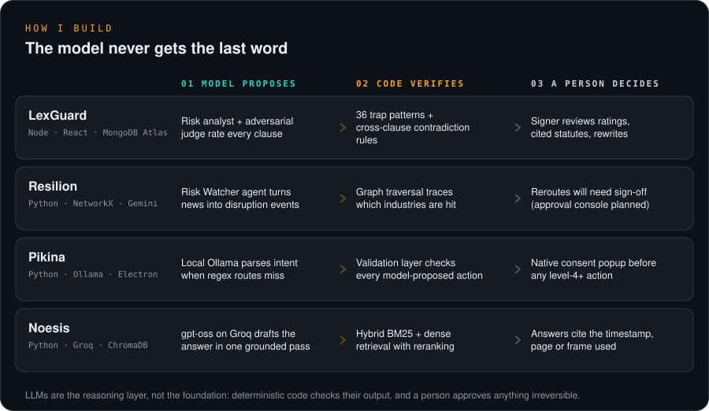

[ LINKEDIN ](https://www.linkedin.com/in/aditya-singh-8286b137a/) &nbsp;·&nbsp; [ EMAIL ](mailto:adityasinghv05@gmail.com) &nbsp;·&nbsp; [ FLAGSHIP: LEXGUARD ](https://github.com/Aditya2514/LexGuard)

<table>
<tr>
<td width="25%"><a href="#01-about"><code>01</code> ABOUT</a></td>
<td width="25%"><a href="#02-how-i-build"><code>02</code> HOW I BUILD</a></td>
<td width="25%"><a href="#03-flagship-systems"><code>03</code> FLAGSHIP</a></td>
<td width="25%"><a href="#04-more-projects"><code>04</code> PROJECTS</a></td>
</tr>
<tr>
<td><a href="#05-live-signal"><code>05</code> SIGNAL</a></td>
<td><a href="#06-stack"><code>06</code> STACK</a></td>
<td><a href="#07-education--honors"><code>07</code> EDUCATION</a></td>
<td><a href="#08-contact"><code>08</code> CONTACT</a></td>
</tr>
</table>

<table>
<tr>
<td width="33%" valign="top">

FLAGSHIP // LEXGUARD 
**AI contract review for Indian law** 
130+ commits · ~25k lines · tests in CI

</td>
<td width="33%" valign="top">

STUDYING // IIT MADRAS 
**BS in Data Science & Applications** 
CGPA 9.0 / 10 · 2025 – 2029

</td>
<td width="33%" valign="top">

LATEST // WIN 
**Paradox DSA Triathlon, IIT Madras** 
Runner-up (2nd place) · 2026

</td>
</tr>
</table>

 

## 01 About

I'm studying for a BS in Data Science & Applications at IIT Madras, co-enrolled at Scaler School of Technology, and I build LLM systems that are safe to act on. In my projects the model is the reasoning layer, not the foundation: deterministic code checks what it says, retrieval grounds it, and a person approves anything that can't be undone.

> *"Language models are lazy-loaded reasoning services sitting on top of deterministic infrastructure, not the thing the infrastructure depends on."* (from the Pikina design notes)

Four rules, each one shipped in a repo:

- **Check the model in code.** LexGuard's 38 trap patterns can overrule the LLM's risk rating, and a contradiction engine cross-checks fees, dates and jurisdictions across clauses.
- **Ground every answer.** Noesis cites the timestamp, page or frame behind each answer; LexGuard cites statutes retrieved from 7,556+ Indian law sections.
- **Ask before acting.** Resilion never reroutes supply without sign-off; Pikina pops a native consent dialog before high-risk OS actions.
- **Degrade, don't die.** LexGuard falls back across four LLM providers and fits its backend in 512 MB; Pikina answers known commands with plain regex routing before it ever calls a model.

 

## 02 How I Build

 

## 03 Flagship Systems

<table>
<tr>
<td width="50%" valign="top">

**◉ LexGuard** 
`N.01` · LEGAL AI · CONTRACT REVIEW

    

Upload an employment, freelance or vendor contract. LexGuard splits it into clauses, rates how risky each one is for the signer, explains it in plain language, cites the Indian statute it touches, and drafts a fairer rewrite.

Engineering notes

 

A sequential agent pipeline (pre-flight context, classifier, risk analyst, adversarial judge, advocate, compliance) runs behind a Redis or MongoDB job queue. After the LLM passes, a deterministic detector with 38 trap patterns can force an escalation, and a reflection loop makes the model explain what it missed. The backend was squeezed into a 512 MB host with a 380 MB heap cap and post-job GC, and the AI client cascades across Gemini, Groq, Hugging Face and local Ollama when a provider runs out of quota.

On the committed benchmarks it gets 28/30 clause types and 21/30 risk tiers right on the master suite, and every miss over-flags rather than under-flags. The offline unit suite runs in CI.

[Source](https://github.com/Aditya2514/LexGuard)

</td>
<td width="50%" valign="top">

**◉ Pikina** 
`N.02` · LOCAL AI · DESKTOP AGENT

   

An offline-first personal operating layer for Windows. Press Alt+Space and type what you want; Pikina routes it, plans it as tasks, runs them, and asks first when an action is risky. Pre-alpha.

Engineering notes

 

Commands that match a known pattern are routed by a Tier 1 regex router in under a millisecond; only misses go to a local Ollama model, with a `no_match` escape hatch to stop it inventing actions. Work runs through a DAG scheduler with starvation protection and a transaction executor that rolls back in reverse order on failure. An Action Validation Layer grades every action, and level 4+ actions need a native Windows confirmation. Event-driven daemons and a dual-tier memory sit underneath.

[Source](https://github.com/Aditya2514/Pikina)

</td>
</tr>
<tr>
<td width="50%" valign="top">

**◉ Resilion** 
`N.03` · AGENTS · SUPPLY-CHAIN RISK

    

India imports most of its crude oil, much of it through the Strait of Hormuz. Resilion watches geopolitical signals and, when a route is at risk, shows which refineries and industries are exposed and ranks alternative supply routes for a person to approve.

Engineering notes

 

Two agents share a NetworkX knowledge graph. The Risk Watcher ingests GDELT, EIA, OFAC and RSS feeds, extracts structured disruption events and scores source confidence. The Procurement Orchestrator traces cascading impact through the graph and ranks reroutes by cost per barrel and added transit days. Recommendations carry the traversal that justifies them, and nothing executes without an approval record.

[Source](https://github.com/Aditya2514/Resilion-)

</td>
<td width="50%" valign="top">

**◉ Noesis** 
`N.04` · MULTIMODAL RAG

   

Ask one question across videos, podcasts, PDFs and scanned pages, and get an answer that points to the exact timestamp, page or frame it came from. Built with [@apurva202](https://github.com/apurva202).

Engineering notes

 

Video and audio go through FFmpeg and Whisper with word-level timestamps; keyframes come from scene-change detection with SSIM de-duplication; PDFs through PyMuPDF and RapidOCR. Entity canonicalisation links a term spoken in a video to the same term in a PDF diagram. Retrieval is hybrid (BM25 + bge-small embeddings) with an ms-marco reranker, and a confidence cutoff decides between a full grounded answer and an extractive fallback.

[Source](https://github.com/Aditya2514/Noesis)

</td>
</tr>
</table>

 

## 04 More Projects

| Project | What it is | Stack |
| :-- | :-- | :-- |
| [**Meta_OpenEnv**](https://github.com/Aditya2514/Meta_OpenEnv) | Built for the Meta PyTorch OpenEnv Hackathon (2026): an OpenEnv environment where an RL or LLM agent triages assignments and production bugs against deadlines and a burnout budget. 110-test suite in CI. Team project. | Python · FastAPI · Docker · HF Spaces |
| [**ShopKart**](https://github.com/Aditya2514/Shopkart) | Full-stack store: JWT auth, catalog, wishlist, cart, server-side checkout, Razorpay payments. Built with [@apurva202](https://github.com/apurva202). | React · Express · MongoDB · Vercel |
| [**C++ shell**](https://github.com/Aditya2514/codecrafters-shell-cpp) | POSIX-style shell from scratch: quoting, redirection, multi-stage pipelines and background jobs on `fork`/`exec`/`pipe`/`dup2`. | C++23 |
| [**Vidya**](https://github.com/Aditya2514/Vidya) | Book discovery app with debounced search, infinite scroll, Firebase and Google sign-in, and persisted saved lists. | React Native · TypeScript · Redux Toolkit |
| [**Fintrac**](https://github.com/Aditya2514/Fintrac) | Personal finance tracker and budget dashboard with Gemini-powered spending analysis. | React · Vite · Recharts |
| [**Naukri**](https://github.com/Aditya2514/Naukri) | Dark-mode job portal UI with API-backed listings and saved jobs. | React · Vite |

 

## 05 Live Signal

<picture>
  <source media="(prefers-color-scheme: dark)" srcset="https://raw.githubusercontent.com/Aditya2514/Aditya2514/output/github-snake-dark.svg" />
  <source media="(prefers-color-scheme: light)" srcset="https://raw.githubusercontent.com/Aditya2514/Aditya2514/output/github-snake.svg" />
  
</picture>

Both are regenerated by GitHub Actions from the GitHub API (stats every 6 hours, snake daily), not typed in by hand.

 

## 06 Stack

<table>
<tr>
<td width="50%" valign="top">

**LANGUAGES** 

**AI / LLM** 

</td>
<td width="50%" valign="top">

**BACKEND & DATA** 

**FRONTEND, MOBILE & INFRA** 

</td>
</tr>
</table>

 

## 07 Education & Honors

**Education**

| Program | Institution | When | Result |
| :-- | :-- | :-- | :-- |
| BS in Data Science & Applications | Indian Institute of Technology Madras | 2025 – 2029 | CGPA **9.0 / 10** |
| Co-enrolled with the IITM BS degree | Scaler School of Technology | 2025 – 2029 | |

**Honors**

| When | Event | Result |
| :-- | :-- | :-- |
| 2026 | Paradox DSA Triathlon, IIT Madras | **Runner-up (2nd place)** |
| 2026 | Meta PyTorch OpenEnv Hackathon | Built and submitted [Meta_OpenEnv](https://github.com/Aditya2514/Meta_OpenEnv) with a team |

 

## 08 Contact

Happy to talk about LLM systems, agents with guardrails, or any of the repos above.

