<picture>
  <source media="(prefers-reduced-motion: reduce) and (max-width: 600px)" srcset="assets/mission/hero-mobile-still.svg" />
  <source media="(prefers-reduced-motion: reduce)" srcset="assets/mission/hero-still.svg" />
  <source media="(max-width: 600px)" srcset="assets/mission/hero-mobile.svg" />
  
</picture>

<b><a href="#select-a-mission">Explore projects</a> &nbsp; / &nbsp; <a href="#engineering-brief">Engineering brief</a> &nbsp; / &nbsp; <a href="#squad-up">Squad up</a></b>

I'm **Aditya Singh**. I build LLM systems, local desktop agents and full-stack products—with a particular interest in **what happens when a model gets something wrong**.

**The model proposes. The system checks. The person stays in control.**

<picture>
  <source media="(max-width: 600px)" srcset="assets/mission/chapter-01-mobile.svg" />
  
</picture>

## The operator

I study **Data Science & Applications at IIT Madras**, co-enrolled at **Scaler School of Technology**. My projects span contract intelligence, local desktop agents, multimodal retrieval and full-stack applications.

What interests me most is the gap between a model producing an answer and a system doing something dependable with it. I work with retrieval, explicit checks and human approval to make that gap easier to inspect.

**Read the situation. Coordinate the squad. Review the mistakes. Queue again.** That is the BGMI energy behind this profile—and the mindset I bring to a build.

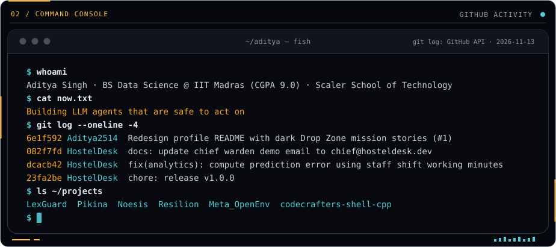

<picture>
  <source media="(max-width: 600px)" srcset="assets/mission/chapter-02-mobile.svg" />
  
</picture>

## Select a mission

Three systems. Three different ways to make AI easier to inspect. Click a card to explore its code.

<a href="https://github.com/Aditya2514/LexGuard">
<picture>
  <source media="(max-width: 600px)" srcset="assets/mission/lexguard-mobile.svg" />
  
</picture>
</a>

**The mission:** make contract risks easier to inspect before signing. LexGuard reviews contracts under Indian law using statutory retrieval and deterministic risk checks.

**Under the hood:** a staged agent pipeline examines clauses, checks explicit traps, verifies citations and proposes rewrites. Deterministic checks can escalate the model’s risk assessment. Its repository documents benchmark context and limitations.

Node.js · React · MongoDB · Redis &nbsp; **[Inspect LexGuard →](https://github.com/Aditya2514/LexGuard)**

<a href="https://github.com/Aditya2514/Pikina">
<picture>
  <source media="(max-width: 600px)" srcset="assets/mission/pikina-mobile.svg" />
  
</picture>
</a>

**The mission:** let a local assistant help with your computer while keeping meaningful actions inspectable. Pikina is an offline-first Windows/Linux assistant with local inference, validated tools and consent for high-risk actions.

**Under the hood:** regex-first routing handles known intents, Ollama supports local inference, and an action validator checks proposed tools. Alias chains support rollback. The project is pre-alpha; the scheduler still awaits its planner.

Python · Electron · Ollama · SQLite · Pre-alpha &nbsp; **[Inspect Pikina →](https://github.com/Aditya2514/Pikina)**

<a href="https://github.com/Aditya2514/Noesis">
<picture>
  <source media="(max-width: 600px)" srcset="assets/mission/noesis-mobile.svg" />
  
</picture>
</a>

**The mission:** find the useful moment across a collection of mixed media. Noesis searches video, audio, PDFs and images, then links answers to timestamps or pages.

**Under the hood:** BM25 and dense retrieval feed a reranker; source citations and an LLM audit help inspect the response. Built with **Apurva Patil**.

Python · ChromaDB · Whisper · Streamlit · Team project &nbsp; **[Inspect Noesis →](https://github.com/Aditya2514/Noesis)**

The animated sequences illustrate mechanisms; they are not live production runs.

## Engineering brief

<picture>
  <source media="(max-width: 600px)" srcset="assets/mission/decision-mobile.svg" />
  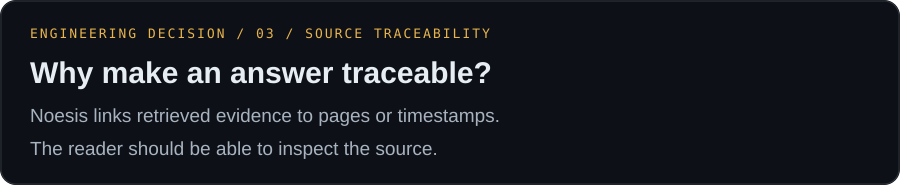
</picture>

**The decisions beneath the visuals**

| System | Design decision | What to inspect |
| :-- | :-- | :-- |
| [LexGuard](https://github.com/Aditya2514/LexGuard) | Deterministic trap checks can escalate an LLM's risk assessment; retrieval grounds statutory citations. | Its README explains benchmarks and limitations. |
| [Pikina](https://github.com/Aditya2514/Pikina) | Validate model proposals against registered capabilities; request consent for high-risk actions. | Alias chains support rollback. The scheduler still awaits its planner. |
| [Noesis](https://github.com/Aditya2514/Noesis) | Combine BM25 and dense retrieval, rerank results, and make sources inspectable. | Source citations and an LLM audit help inspect answers. Built with Apurva Patil. |
| [Resilion](https://github.com/Aditya2514/Resilion) | Turn news into structured risk events and trace affected industries through a supply graph. | Graph and Risk Watcher built; rerouting, API and approval console are planned. |

**Mission replay — an illustrative LexGuard walkthrough**


<picture>
  <source media="(max-width: 600px)" srcset="assets/mission/chapter-03-mobile.svg" />
  
</picture>

## Project lobby

**Also building [Resilion](https://github.com/Aditya2514/Resilion):** supply-chain intelligence with a Risk Watcher and impact graph. Python · NetworkX · Gemini. In progress.

<!-- PROJECT-LOBBY:START -->

<a href="https://github.com/Aditya2514/HostelDesk">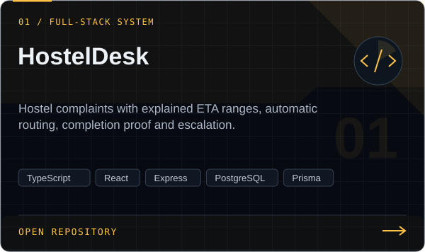</a>
<a href="https://github.com/Aditya2514/Meta_OpenEnv">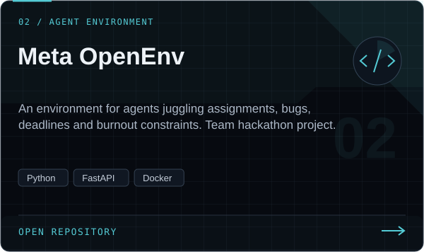</a>

<a href="https://github.com/Aditya2514/Shopkart">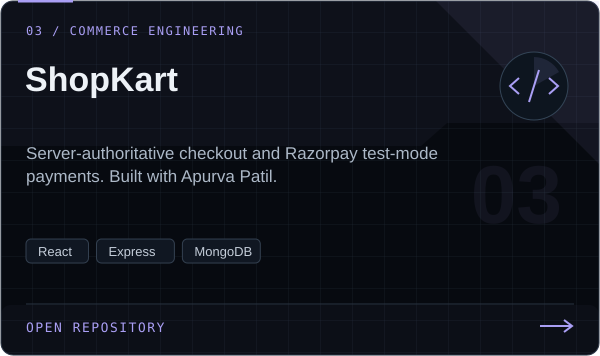</a>
<a href="https://github.com/Aditya2514/codecrafters-shell-cpp">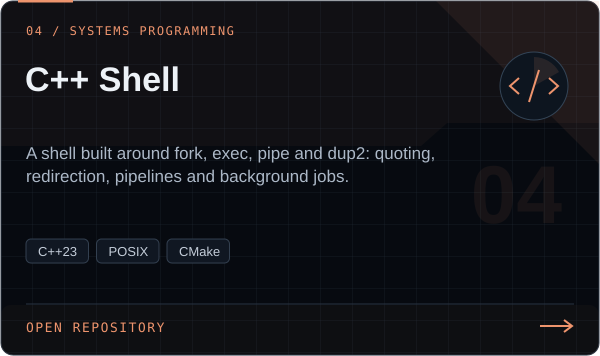</a>

<a href="https://github.com/Aditya2514/Vidya">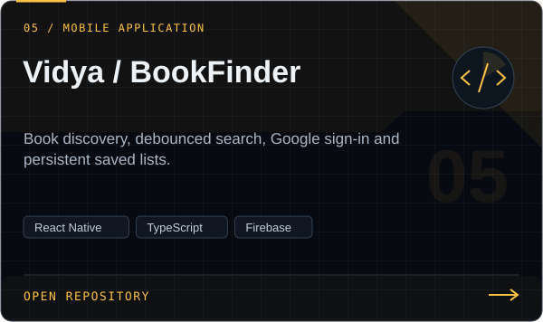</a>
<a href="https://github.com/Aditya2514/Fintrac">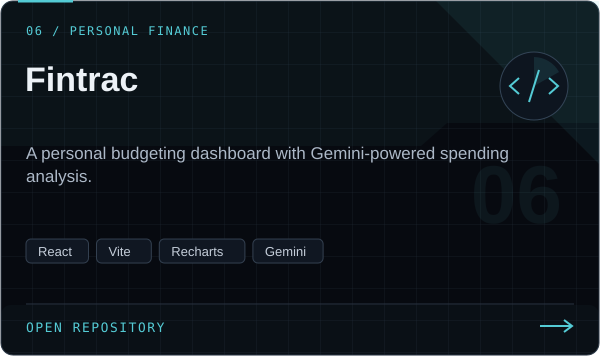</a>

<a href="https://github.com/Aditya2514/Naukri">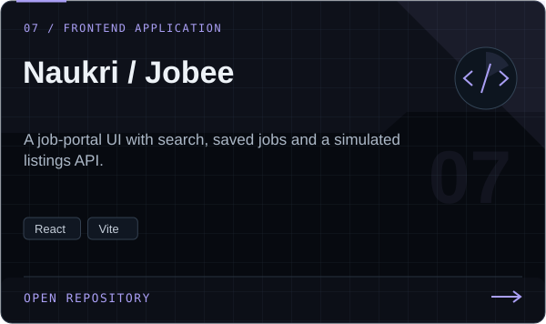</a>
<a href="https://github.com/Aditya2514/BenchShield">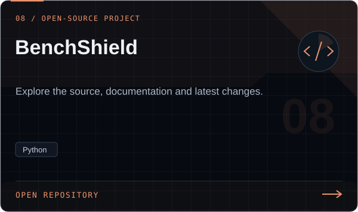</a>

<a href="https://github.com/Aditya2514/Mobius">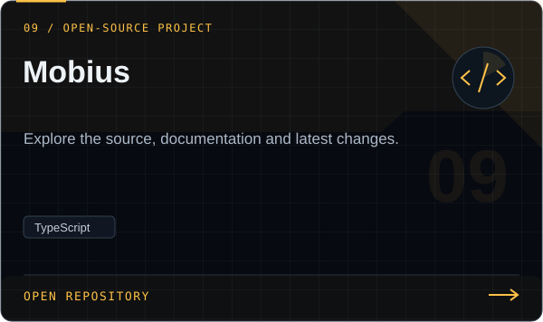</a>
<a href="https://github.com/Aditya2514?tab=repositories">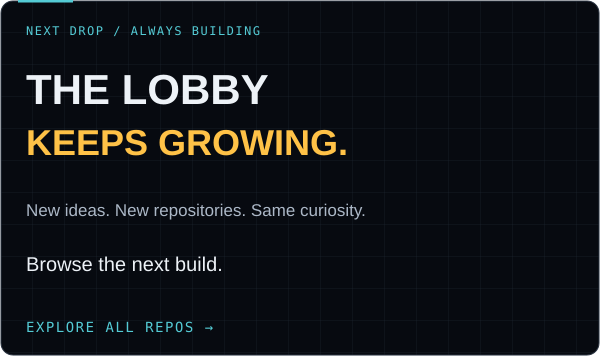</a>

<!-- PROJECT-LOBBY:END -->

[Earlier experiments](https://github.com/Aditya2514?tab=repositories): FinancePro · Simple Soundboard · First portfolio.

<picture>
  <source media="(max-width: 600px)" srcset="assets/mission/chapter-04-mobile.svg" />
  
</picture>

## Build kit

<picture>
  <source media="(max-width: 600px)" srcset="assets/mission/arsenal-mobile.svg" />
  
</picture>

## Utility belt

**Game wali utility. Builder wala purpose.** Four animated links into the work.

<a href="https://github.com/Aditya2514/Noesis"></a>
<a href="https://github.com/Aditya2514/LexGuard"></a>

<a href="https://github.com/Aditya2514/codecrafters-shell-cpp"></a>
<a href="https://github.com/Aditya2514/HostelDesk"></a>

<picture>
  <source media="(max-width: 600px)" srcset="assets/mission/chapter-05-mobile.svg" />
  
</picture>

## Match history

## Build transmissions

<!-- MISSION-FEED:START -->

| Repository | Recent change | Date (UTC) |
| :-- | :-- | :-- |
| Pikina | [fix(switcher): review findings — Ctrl+C, git config execution, robustness](https://github.com/Aditya2514/Pikina/commit/21e6e432e8653851d9680c458f8814e7e942b6e9) | 2026-10-22 |
| Pikina | [feat: project switcher (&quot;work on &lt;project&gt;&quot;) as the built-in workspace plugin](https://github.com/Aditya2514/Pikina/commit/a1b73fa721aaa649689d0b1412fa3d13e56c6f09) | 2026-10-22 |
| Pikina | [phase1: close the gaps found when re-verifying the review fixes](https://github.com/Aditya2514/Pikina/commit/11b49a84714332dfcaa3a8681c22d143dbd24271) | 2026-10-22 |

Recent non-merge changes from LexGuard, Pikina and Noesis. Refreshed 08 Nov 2026, 22:04 UTC. Scheduled every six hours; the last successful snapshot stays visible if refresh fails.

<!-- MISSION-FEED:END -->

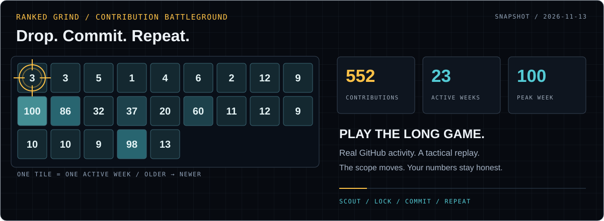

Generated from GitHub data. Scheduled every six hours; each card keeps its last successful update.

<picture>
  <source media="(max-width: 600px)" srcset="assets/mission/chapter-06-mobile.svg" />
  
</picture>

## Career campaign


| Education | Achievement |
| :-- | :-- |
| **IIT Madras** · BS Data Science & Applications · 2025–2029 · CGPA **9.0/10** | **Runner-up** · Paradox DSA Triathlon · IIT Madras · 2026 |
| **Scaler School of Technology** · 2025–2029 | **Meta PyTorch OpenEnv Hackathon** · 2026 · Team submission |

**The BGMI connection:** read the situation, communicate with the squad, learn from the replay, queue again. That same competitive curiosity shapes how I build.

<picture>
  <source media="(max-width: 600px)" srcset="assets/mission/outro-mobile.svg" />
  
</picture>

## Squad up

Interested in **AI engineering internships**, **agent systems**, or a **hackathon project**? Send me the problem you're working on.

**[LinkedIn ↗](https://www.linkedin.com/in/aditya-singh-8286b137a/)** &nbsp; / &nbsp; **[Email ↗](mailto:adityasinghv05@gmail.com)** &nbsp; / &nbsp; **[All repositories ↗](https://github.com/Aditya2514?tab=repositories)**

---

<b>GG. Now go inspect the code.</b> BGMI-inspired spirit. Engineering you can inspect.

