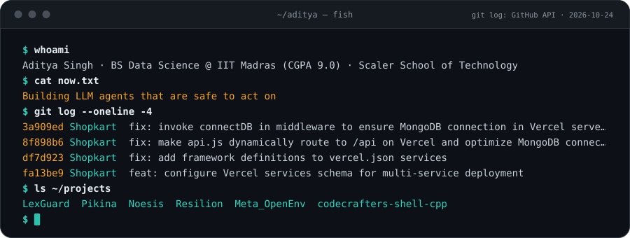
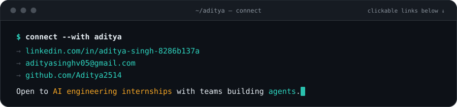

[ LINKEDIN ](https://www.linkedin.com/in/aditya-singh-8286b137a/) &nbsp;·&nbsp; [ EMAIL ](mailto:adityasinghv05@gmail.com) &nbsp;·&nbsp; [ FLAGSHIP: LEXGUARD ](https://github.com/Aditya2514/LexGuard)

<table>
<tr>
<td width="25%"><a href="#01-about"><code>01</code> ABOUT</a></td>
<td width="25%"><a href="#02-how-i-build"><code>02</code> HOW I BUILD</a></td>
<td width="25%"><a href="#03-flagship-systems"><code>03</code> FLAGSHIP</a></td>
<td width="25%"><a href="#04-more-projects"><code>04</code> PROJECTS</a></td>
</tr>
<tr>
<td><a href="#05-live-signal"><code>05</code> SIGNAL</a></td>
<td><a href="#06-stack"><code>06</code> STACK</a></td>
<td><a href="#07-education--honors"><code>07</code> EDUCATION</a></td>
<td><a href="#08-contact"><code>08</code> CONTACT</a></td>
</tr>
</table>

 

## 01 About

I'm studying for a BS in Data Science & Applications at IIT Madras, co-enrolled at Scaler School of Technology, and I build LLM systems that are safe to act on. In my projects the model is the reasoning layer, not the foundation: deterministic code checks what it says, retrieval grounds it, and a person approves anything that can't be undone.

> *"Language models are lazy-loaded reasoning services sitting on top of deterministic infrastructure, not the thing the infrastructure depends on."* (from the Pikina design notes)

Four rules, each one shipped in a repo:

- **Check the model in code.** LexGuard's 36 trap patterns can overrule the LLM's risk rating, and a contradiction engine cross-checks fees, dates and jurisdictions across clauses.
- **Ground every answer.** Noesis answers cite the timestamp, page or frame behind each claim, and an LLM auditor checks them; LexGuard cites statutes retrieved from 7,556+ Indian law sections.
- **Ask before acting.** Pikina validates every model-proposed action against a tool manifest and pops a native consent dialog before high-risk OS actions.
- **Degrade, don't die.** LexGuard falls back across four LLM providers and fits its backend in 512 MB; Pikina answers known commands with plain regex routing before it ever calls a model.

 

## 02 How I Build

 

## 03 Flagship Systems

 

Each card loops an illustrative run of the real mechanism. Click a card for the repo.

<b>LexGuard: under the hood</b>

 

A staged agent pipeline (pre-flight context, classifier, risk analyst with an adversarial judge, deterministic audit, advocate and compliance in parallel, citation verifier, drafter) runs behind a Redis or MongoDB job queue. After the LLM passes, a deterministic detector with 36 trap patterns can force an escalation, and a reflection loop makes the model explain what it missed. The backend was squeezed into a 512 MB host with a 380 MB heap cap and post-job GC, and the AI client cascades across Gemini, Groq, Hugging Face and local Ollama when a provider runs out of quota.

On the committed May 2026 benchmark runs it got 28/30 clause types and 21/30 risk tiers right, and every miss over-flagged rather than under-flagged. Rules that matched benchmark text word for word were removed in October 2026, so a fresh run is pending. The offline unit suite runs in CI.

<b>Pikina: under the hood</b>

 

Commands that match a known pattern are handled by a Tier 1 regex router with no model call; only misses go to a local Ollama model, which must return a registered tool or `no_match`, so it can't invent actions. An Action Validation Layer checks every model-proposed action against the tool manifest, and level 4+ actions from either tier need a native confirmation dialog (MessageBoxW on Windows, zenity or kdialog on Linux). Multi-step alias chains run through a transactional executor that undoes completed steps in reverse order if one fails; a DAG scheduler with starvation protection is built and tested, waiting for the planner that will call it. Event-driven daemons and a dual-tier memory sit underneath.

<b>Resilion: built vs planned</b>

 

Built so far: data sources for GDELT, EIA, OFAC and RSS feeds, a Gemini Risk Watcher agent that turns them into structured disruption events, and a NetworkX graph of India's crude-oil supply corridors that traces which industries an event affects. Next: a Procurement Orchestrator that ranks reroutes by cost and transit delay, and an approval console so nothing executes without a person signing off.

<b>Noesis: under the hood</b>

 

Video and audio go through FFmpeg and Whisper with word-level timestamps; keyframes come from scene-change detection with perceptual-hash de-duplication; PDFs through PyMuPDF and RapidOCR. Entity canonicalisation links a term spoken in a video to the same term in a PDF diagram. Retrieval is hybrid (BM25 + bge-small embeddings) with an ms-marco reranker, and a confidence cutoff decides between a full grounded answer and an extractive fallback.

 

## 04 More Projects

| Project | What it is | Stack |
| :-- | :-- | :-- |
| [**Meta_OpenEnv**](https://github.com/Aditya2514/Meta_OpenEnv) | Built for the Meta PyTorch OpenEnv Hackathon (2026): an OpenEnv environment where an RL or LLM agent triages assignments and production bugs against deadlines and a burnout budget. 110-test suite in CI. Team project. | Python · FastAPI · Docker · HF Spaces |
| [**ShopKart**](https://github.com/Aditya2514/Shopkart) | Full-stack store: JWT auth, catalog, wishlist, cart, server-side checkout, Razorpay payments. Built with [@apurva202](https://github.com/apurva202). | React · Express · MongoDB · Vercel |
| [**C++ shell**](https://github.com/Aditya2514/codecrafters-shell-cpp) | POSIX-style shell from scratch: quoting, redirection, multi-stage pipelines and background jobs on `fork`/`exec`/`pipe`/`dup2`. | C++23 |
| [**Vidya**](https://github.com/Aditya2514/Vidya) | Book discovery app with debounced search, infinite scroll, Firebase and Google sign-in, and persisted saved lists. | React Native · TypeScript · Redux Toolkit |
| [**Fintrac**](https://github.com/Aditya2514/Fintrac) | Personal finance tracker and budget dashboard with Gemini-powered spending analysis. | React · Vite · Recharts |
| [**Naukri**](https://github.com/Aditya2514/Naukri) | Dark-mode job portal UI with API-backed listings and saved jobs. | React · Vite |

 

## 05 Live Signal

<picture>
  <source media="(prefers-color-scheme: dark)" srcset="https://raw.githubusercontent.com/Aditya2514/Aditya2514/output/github-snake-dark.svg" />
  <source media="(prefers-color-scheme: light)" srcset="https://raw.githubusercontent.com/Aditya2514/Aditya2514/output/github-snake.svg" />
  
</picture>

Generated from the GitHub API by GitHub Actions, not typed in by hand: stats, build rhythm and the terminal's git log refresh every 6 hours; the snake daily.

 

## 06 Stack

 

## 07 Education & Honors

 

**Education**

| Program | Institution | When | Result |
| :-- | :-- | :-- | :-- |
| BS in Data Science & Applications | Indian Institute of Technology Madras | 2025 – 2029 | CGPA **9.0 / 10** |
| Co-enrolled with the IITM BS degree | Scaler School of Technology | 2025 – 2029 | |

**Honors**

| When | Event | Result |
| :-- | :-- | :-- |
| 2026 | Paradox DSA Triathlon, IIT Madras | **Runner-up (2nd place)** |
| 2026 | Meta PyTorch OpenEnv Hackathon | Built and submitted [Meta_OpenEnv](https://github.com/Aditya2514/Meta_OpenEnv) with a team |

 

## 08 Contact

