
<picture>
  <source media="(max-width: 600px)" srcset="assets/atlas/hero-mobile.svg" />
  
</picture>

<b><a href="#systems">Systems</a> &nbsp;·&nbsp; <a href="#more-builds">More builds</a> &nbsp;·&nbsp; <a href="#signal">Signal</a> &nbsp;·&nbsp; <a href="#contact">Contact</a></b>

I'm **Aditya Singh**. I build LLM systems, local desktop agents and full-stack products, and the part I care about most is **what happens when the model is wrong**. So I treat a model's output as a proposal: retrieval grounds it, explicit checks can overrule it, and a person approves anything that matters.

## Systems

Three projects, one rule. Select a card to read the code.

<a href="https://github.com/Aditya2514/LexGuard"><picture>
  <source media="(max-width: 600px)" srcset="assets/atlas/lexguard-mobile.svg" />
  
</picture></a>

<a href="https://github.com/Aditya2514/Pikina"><picture>
  <source media="(max-width: 600px)" srcset="assets/atlas/pikina-mobile.svg" />
  
</picture></a>

<a href="https://github.com/Aditya2514/Noesis"><picture>
  <source media="(max-width: 600px)" srcset="assets/atlas/noesis-mobile.svg" />
  
</picture></a>

The diagrams illustrate how each system works; they are not recordings of real runs.

## More builds

<!-- PROJECT-LOBBY:START -->

<a href="https://github.com/Aditya2514/Resilion"><picture><source media="(max-width: 600px)" srcset="assets/atlas/repo/resilion-mini.svg" /></picture></a>
<a href="https://github.com/Aditya2514/HostelDesk"><picture><source media="(max-width: 600px)" srcset="assets/atlas/repo/hosteldesk-mini.svg" /></picture></a>

<a href="https://github.com/Aditya2514/Meta_OpenEnv"><picture><source media="(max-width: 600px)" srcset="assets/atlas/repo/meta_openenv-mini.svg" /></picture></a>
<a href="https://github.com/Aditya2514/Shopkart"><picture><source media="(max-width: 600px)" srcset="assets/atlas/repo/shopkart-mini.svg" /></picture></a>

<a href="https://github.com/Aditya2514/codecrafters-shell-cpp"><picture><source media="(max-width: 600px)" srcset="assets/atlas/repo/codecrafters-shell-cpp-mini.svg" /></picture></a>
<a href="https://github.com/Aditya2514/Vidya"><picture><source media="(max-width: 600px)" srcset="assets/atlas/repo/vidya-mini.svg" /></picture></a>

<a href="https://github.com/Aditya2514/Fintrac"><picture><source media="(max-width: 600px)" srcset="assets/atlas/repo/fintrac-mini.svg" /></picture></a>
<a href="https://github.com/Aditya2514/Naukri"><picture><source media="(max-width: 600px)" srcset="assets/atlas/repo/naukri-mini.svg" /></picture></a>

<a href="https://github.com/Aditya2514/BenchShield"><picture><source media="(max-width: 600px)" srcset="assets/atlas/repo/benchshield-mini.svg" /></picture></a>
<a href="https://github.com/Aditya2514/Mobius"><picture><source media="(max-width: 600px)" srcset="assets/atlas/repo/mobius-mini.svg" /></picture></a>

<!-- PROJECT-LOBBY:END -->

This grid is generated from my public repositories, so new projects appear on their own. <a href="https://github.com/Aditya2514?tab=repositories">Earlier experiments</a>: FinancePro · Simple Soundboard · First portfolio.

## Build kit

<picture>
  <source media="(max-width: 600px)" srcset="assets/atlas/kit-mobile.svg" />
  
</picture>

## Signal

<picture>
  <source media="(max-width: 600px)" srcset="assets/atlas/pulse-mobile.svg" />
  
</picture>

<!-- MISSION-FEED:START -->

| Repository | Latest change | Date |
| :-- | :-- | :-- |
| [HostelDesk](https://github.com/Aditya2514/HostelDesk) | [docs: update chief warden demo email to chief@hosteldesk.dev](https://github.com/Aditya2514/HostelDesk/commit/082f7fdcd7cda0695ad06f2a56d4cd5c5d1c3864) | 2026-10-27 |
| [HostelDesk](https://github.com/Aditya2514/HostelDesk) | [fix(analytics): compute prediction error using staff shift working minutes](https://github.com/Aditya2514/HostelDesk/commit/dcacb427049f3784102edf963d183c0df332708a) | 2026-10-26 |
| [HostelDesk](https://github.com/Aditya2514/HostelDesk) | [chore: release v1.0.0](https://github.com/Aditya2514/HostelDesk/commit/23fa2beb254f40ad6d8a19eb80c32089873ad10d) | 2026-10-26 |
| [HostelDesk](https://github.com/Aditya2514/HostelDesk) | [test: production smoke script](https://github.com/Aditya2514/HostelDesk/commit/f2ca8d8e7b35ebd37da86101d8ed01b7c2ae33a1) | 2026-10-26 |

My latest commits, excluding merges and bots. Snapshot 2026-11-14; refreshed every six hours.

<!-- MISSION-FEED:END -->

## Route

<picture>
  <source media="(max-width: 600px)" srcset="assets/atlas/route-mobile.svg" />
  
</picture>

## Contact

<picture>
  <source media="(max-width: 600px)" srcset="assets/atlas/contact-mobile.svg" />
  
</picture>

Off the clock I play BGMI: read the zone, call the play, review the replay, queue again. The same loop shapes how I build.

